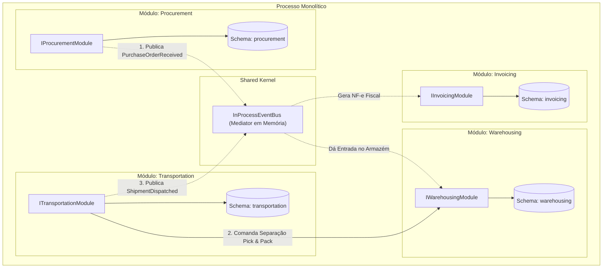

# Exemplo 05: Cadeia de Suprimentos e Logística Integrada (Supply Chain & Logistics)

Este exemplo demonstra a **Modular Monolith Architecture** em um ecossistema de cadeia de suprimentos e logística integrada para a indústria, composto por quatro módulos:
- **`Procurement`**: Gestão de pedidos de compras com fornecedores e homologação de remessas entregues.
- **`Warehousing`**: Armazenagem em centros de distribuição, mapeamento de corredores/docas e controle físico de saldos.
- **`Transportation`**: Roteirização, separação física (pick & pack) e despacho de caminhões para clientes finais.
- **`Invoicing`**: Emissão automatizada de Notas Fiscais Eletrônicas (NF-e) com retenção tributária (ICMS e IPI).

---

## 🎯 Bounded Contexts e Fluxo Reativo

1. **Entrada de Suprimentos:** Quando o módulo `Procurement` confirma a chegada da mercadoria física (`receive_order`), ele dispara `PurchaseOrderReceivedDomainEvent`. O módulo `Warehousing` reage alocando automaticamente o lote nas prateleiras sem acoplamento direto com compras.
2. **Separação e Expedição de Cargas:** O módulo `Transportation` solicita a separação física de itens via contrato público de `Warehousing`. Ao confirmar o carregamento do caminhão, publica `ShipmentDispatchedDomainEvent`.
3. **Faturamento Fiscal:** O módulo `Invoicing` escuta o despacho e gera a NF-e com cálculo de impostos, sem que o motorista ou o despachante precisem operar o sistema fiscal diretamente.

---

## 🏛️ Diagrama de Módulos e Interações (Mermaid)



---

## 📁 Estrutura de Pastas

```
05-logistics-supply-chain/
├── shared/
│   ├── __init__.py
│   └── events.py
├── modules/
│   ├── procurement/
│   │   ├── __init__.py
│   │   ├── public_contracts.py
│   │   ├── procurement_module.py
│   │   └── internal/
│   │       └── procurement_internal.py
│   ├── warehousing/
│   │   ├── __init__.py
│   │   ├── public_contracts.py
│   │   ├── warehousing_module.py
│   │   └── internal/
│   │       └── warehousing_internal.py
│   ├── transportation/
│   │   ├── __init__.py
│   │   ├── public_contracts.py
│   │   ├── transportation_module.py
│   │   └── internal/
│   │       └── transportation_internal.py
│   └── invoicing/
│       ├── __init__.py
│       ├── public_contracts.py
│       ├── invoicing_module.py
│       └── internal/
│           └── invoicing_internal.py
├── main.py
└── README.md
```

---

## 🚀 Como Executar

Execute o comando a partir do diretório raiz:

```bash
python3 08-modular-monolith/05-logistics-supply-chain/main.py
```

### Cenários Validados no Teste:
1. **Compra e Entrada Automática em Estoque:** Recebimento de 50 motores elétricos reflete imediatamente no saldo do armazém no Corredor A.
2. **Expedição e Baixa de Armazém:** Despacho de 20 unidades com transporte para Embraer baixa fisicamente o saldo para 30 unidades.
3. **Emissão Fiscal Integrada:** Evento de transporte gera a respectiva NF-e contendo destaque de ICMS (18%) e IPI (5%).
4. **Proteção Contra Ruptura:** Bloqueio imediato ao tentar expedir quantidade além do saldo físico disponível no armazém.
