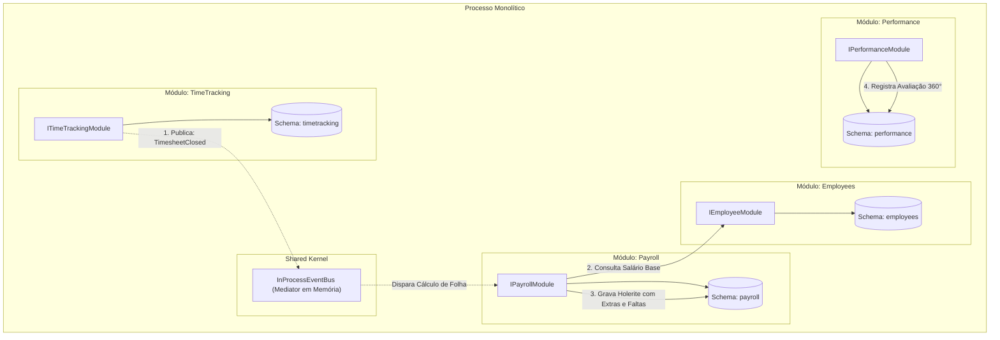

# Exemplo 06: Suite de Recursos Humanos e Departamento Pessoal (Human Resources Suite)

Este exemplo demonstra a **Modular Monolith Architecture** em um sistema corporativo de Recursos Humanos e Departamento Pessoal (DP), estruturado em quatro módulos:
- **`Employees`**: Quadro de funcionários, cargos, departamentos, salários base e admissão.
- **`TimeTracking`**: Registro de jornada, horas extras e faltas injustificadas no espelho de ponto mensal.
- **`Payroll`**: Processamento de folha de pagamento e emissão de holerites a partir de eventos de ponto.
- **`Performance`**: Avaliação de desempenho 360°, feedbacks executivos e categorização de metas.

---

## 🎯 Bounded Contexts e Integração Reativa

1. **Separação entre Ponto e Pagamento:** O módulo `TimeTracking` cuida exclusivamente de marcação e auditoria de horários. Ele não calcula dinheiro nem sabe a fórmula de horas extras com adicional de 50%.
2. **Reatividade na Emissão de Holerites:** Ao fechar o ponto mensal (`close_month_timesheet`), o evento `TimesheetClosedDomainEvent` é publicado no barramento em memória (`InProcessEventBus`).
3. **Cálculo Desacoplado no Payroll:** O módulo `Payroll` consome o evento, consulta o salário base no módulo `Employees` via sua interface pública `IEmployeeModule` e calcula o holerite líquido sem dependências diretas de banco de dados.
4. **Isolamento de Performance:** O módulo `Performance` armazena avaliações de liderança com autonomia e sigilo de feedbacks.

---

## 🏛️ Diagrama de Módulos e Interações (Mermaid)



---

## 📁 Estrutura de Pastas

```
06-human-resources-suite/
├── shared/
│   ├── __init__.py
│   └── events.py
├── modules/
│   ├── employees/
│   │   ├── __init__.py
│   │   ├── public_contracts.py
│   │   ├── employees_module.py
│   │   └── internal/
│   │       └── employees_internal.py
│   ├── timetracking/
│   │   ├── __init__.py
│   │   ├── public_contracts.py
│   │   ├── timetracking_module.py
│   │   └── internal/
│   │       └── timetracking_internal.py
│   ├── payroll/
│   │   ├── __init__.py
│   │   ├── public_contracts.py
│   │   ├── payroll_module.py
│   │   └── internal/
│   │       └── payroll_internal.py
│   └── performance/
│       ├── __init__.py
│       ├── public_contracts.py
│       ├── performance_module.py
│       └── internal/
│           └── performance_internal.py
├── main.py
└── README.md
```

---

## 🚀 Como Executar

Execute o comando a partir do diretório raiz do repositório:

```bash
python3 08-modular-monolith/06-human-resources-suite/main.py
```

### Cenários Validados no Teste:
1. **Admissão de Colaboradores:** Cadastro de Engenheiro Sênior e Tech Lead com salários e cargos distintos.
2. **Fechamento de Ponto Eletrônico:** Apuração de 12 horas extras para o primeiro colaborador e 2 dias de faltas injustificadas para a segunda colaboradora.
3. **Processamento Reativo de Holerites:** Cálculo das horas extras (+50%) e desconto proporcional das faltas acionado automaticamente por evento intra-processo.
4. **Ciclo de Avaliação 360°:** Submissão de notas e pareceres de liderança com classificação de desempenho (`EXCEEDS_EXPECTATIONS` e `MEETS_EXPECTATIONS`).
