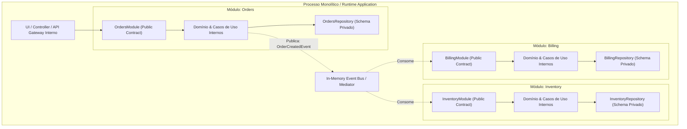

# 🏛️ Modular Monolith Architecture (Monólito Modular)

> *"A complex system that works is invariably found to have evolved from a simple system that worked. A complex system designed from scratch never works and cannot be patched up to make it work."*  
> — **John Gall (Gall's Law)**

---

## 📖 1. O que é e Origem Histórica

A **Arquitetura de Monólito Modular (Modular Monolith)** é uma abordagem arquitetural em que um sistema de software é estruturado como um **único artefato executável e implantável (deploy único)**, porém dividido internamente em **módulos estritamente independentes e fracamente acoplados**, cada um representando um **Bounded Context (Contexto Delimitado)** do negócio.

### A Reação aos "Microservices Prematuros"
Entre 2014 e 2020, o ecossistema global de tecnologia testemunhou uma migração em massa para microsserviços. Muitas equipes, no entanto, enfrentaram as dores brutais dos sistemas distribuídos sem possuírem a maturidade operacional exigida:
- Latência de rede em chamadas encadeadas (falhas em cascata);
- Dificuldade extrema de transações atômicas (consistência eventual, Sagas complexas);
- Explosão de custos com observabilidade distribuída, service meshes e clusters Kubernetes;
- O temido **"Monólito Distribuído"** (*Distributed Monolith*): o pior dos dois mundos, onde os serviços eram separados fisicamente mas acoplados logicamente, exigindo deploys sincronizados.

Pioneiros como **Martin Fowler**, **Kamil Grzybek** (autor de *Modular Monolith: A Primer*) e **Simon Brown** (criador do modelo C4) formalizaram o Monólito Modular como o padrão ouro para sistemas que necessitam de **alta coesão e isolamento de domínio**, sem a complexidade operacional de uma rede física distribuída.

---

## 🧩 2. Conceitos Fundamentais

Um Monólito Modular é fundamentado em quatro pilares inegociáveis:

```
┌────────────────────────────────────────────────────────────────────────┐
│                        PROCESSO ÚNICO (MONÓLITO)                        │
│                                                                        │
│   ┌─────────────────────┐                    ┌─────────────────────┐   │
│   │   MÓDULO: ORDERS    │                    │  MÓDULO: INVENTORY  │   │
│   │ ┌─────────────────┐ │                    │ ┌─────────────────┐ │   │
│   │ │ Public API /    │ │                    │ │ Public API /    │ │   │
│   │ │ Module Contract │◀┼────── In-Process ──┼▶│ Module Contract │ │   │
│   │ └────────┬────────┘ │      Event Bus /   │ └────────┬────────┘ │   │
│   │          │          │      Direct Call   │          │          │   │
│   │ ┌────────▼────────┐ │                    │ ┌────────▼────────┐ │   │
│   │ │ Internal Domain │ │                    │ │ Internal Domain │ │   │
│   │ │ & Persistence   │ │                    │ │ & Persistence   │ │   │
│   │ └─────────────────┘ │                    │ └─────────────────┘ │   │
│   └──────────┬──────────┘                    └──────────┬──────────┘   │
│              │                                          │              │
│              ▼                                          ▼              │
│     Schema: `orders`                           Schema: `inventory`     │
│       (Isolado)                                  (Isolado)             │
└────────────────────────────────────────────────────────────────────────┘
```

1. **Fronteiras Explícitas de Módulo (Module Boundaries):** Cada módulo possui um contrato público (`public_api` ou `contracts`) e uma implementação interna estritamente privada (`internal` ou `domain/infrastructure`). Código de fora só pode importar o que estiver exportado na API pública.
2. **Isolamento de Dados (Data Independence):** Nenhum módulo acessa tabelas, coleções ou estruturas de dados de outro módulo. Em banco de dados relacional, cada módulo possui seu próprio schema/tabelas; queries com `JOIN` entre schemas de módulos distintos são expressamente proibidas.
3. **Comunicação Intra-Processo Desacoplada:**
   - **Síncrona:** Invocação direta da interface pública (`IOrdersModuleAPI`).
   - **Assíncrona / Reativa:** Publicação de eventos de domínio em um `InProcessEventBus` / `Mediator` na memória do processo, permitindo consistência eventual entre módulos.
4. **Caminho Suave para Microsserviços (Extractability):** Se um módulo específico exigir escalabilidade física distinta (ex: o motor de pagamentos ou recomendação), ele pode ser extraído para um microsserviço independente em dias, pois suas dependências já estão encapsuladas em contratos explícitos.

---

## 📐 3. Diagramas Conceituais (Mermaid)

### Arquitetura de Módulos e Contratos Públicos



---

## 🚫 4. Regras Invariantes (O que NUNCA Fazer)

| Invariante | Por que Viola a Arquitetura? | O que Fazer no Lugar? |
|---|---|---|
| **❌ Importar classes internas de outro módulo** | Quebra a encapsulação; qualquer refatoração interna quebra consumidores externos. | Consumir exclusivamente a interface ou DTOs expostos no contrato público (`api/contracts.py`). |
| **❌ Fazer JOIN de banco entre tabelas de módulos diferentes** | Cria acoplamento de persistência impossível de separar depois. | Consultar o módulo via sua API pública ou duplicar projeções desnormalizadas via eventos. |
| **❌ Dependência circular entre módulos (Módulo A -> Módulo B -> Módulo A)** | Impede a modularização e gera nós de compilação/importação insolúveis. | Inverter a dependência através de eventos em memória (`EventBus`) ou extrair um módulo compartilhado. |
| **❌ Transação única de banco englobando múltiplos módulos** | Força dependência temporal e dificulta a extração futura para serviços independentes. | Usar transações atômicas por módulo e orquestração de consistência via eventos ou Sagas locais. |

---

## ⚖️ 5. Vantagens e Trade-offs Reais

### Vantagens:
- **Zero Latência de Rede:** Chamadas entre módulos ocorrem na memória RAM (nanossegundos), sem serialização JSON/gRPC nem conexões TCP.
- **Deploy e Operação Triviais:** Um único pipeline de CI/CD, um único container Docker e um único monitoramento de processo.
- **Transição Barata:** Refatorações entre contextos podem ser feitas com ferramentas de IDE e checagem de tipos sem medo de quebrar contratos remotos.
- **Depuração e Testabilidade Local:** Testes end-to-end e integrados rodam em milissegundos sem necessidade de levantar 10 containers locais.

### Trade-offs & Desafios:
- **Exige Disciplina Extrema da Equipe:** Em linguagens dinâmicas como Python, é tentador burlar as fronteiras e importar arquivos internos diretamente. Ferramentas de linting arquitetural (ex: `import-linter`) são fundamentais.
- **Escala de Deploy Compartilhada:** Todo o monólito é recompilado e reiniciado no deploy, mesmo que apenas um módulo tenha sido alterado.
- **Gargalo de Recursos:** Se um módulo tiver um vazamento de memória (Memory Leak) ou consumir 100% da CPU, todo o processo do monólito é afetado.

---

## 🎯 6. Quando Usar vs Quando NÃO Usar

### Quando Usar:
- Sistemas com múltiplos domínios de negócio complexos em empresas em crescimento (90% dos casos).
- Equipes que querem a clareza de microsserviços sem o custo astronômico de infraestrutura distribuída.
- Fases de descoberta de produto onde as fronteiras dos contextos ainda estão mudando.

### Quando NÃO Usar:
- Sistemas pequenos de domínio único (prefira Layered ou Hexagonal puro).
- Quando diferentes partes do sistema exigem linguagens de programação completamente diferentes (ex: C++ para vídeo e Python para IA).
- Quando partes do sistema exigem ciclos de deploy por times independentes de 500+ desenvolvedores.

---

## 📂 7. Catálogo dos 6 Exemplos Práticos Implementados

| # | Exemplo | Módulos Envolvidos | Mecanismos Chave |
|---|---|---|---|
| **01** | [`01-ecommerce-modular-erp`](./01-ecommerce-modular-erp/) | Catalog, Orders, Inventory, Payment | Contratos públicos (`OrdersAPI`, `InventoryAPI`), In-Memory Mediator assíncrono. |
| **02** | [`02-healthcare-clinic-management`](./02-healthcare-clinic-management/) | Patients, Appointments, Billing, MedicalRecords | Isolamento estrito de prontuários médicos (LGPD/HIPAA), eventos de agendamento. |
| **03** | [`03-saas-multitenant-crm`](./03-saas-multitenant-crm/) | Identity/Auth, Leads/Pipeline, Subscriptions, Audit | Tenant isolation, barramento de auditoria em memória, controle de limites por plano. |
| **04** | [`04-fintech-digital-wallet`](./04-fintech-digital-wallet/) | Accounts, Transfers/PIX, Compliance/KYC, Notifications | Regras de compliance antilavagem em tempo de transferência, saldo com conciliação. |
| **05** | [`05-logistics-supply-chain`](./05-logistics-supply-chain/) | Procurement, Warehousing, Transportation, Invoicing | Orquestração de recebimento de suprimentos, despacho de caminhões e emissão fiscal. |
| **06** | [`06-human-resources-suite`](./06-human-resources-suite/) | Employees, TimeTracking, PayrollIntegration, Performance | Fechamento de ponto eletrônico, integração de holerite e avaliação 360°. |
