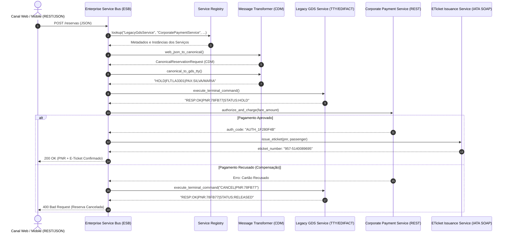

# Exemplo 01: Reserva e Emissão Aérea com GDS e ESB (Airline GDS Integration)

Este exemplo demonstra a aplicação da **Service-Oriented Architecture (SOA)** na integração entre canais modernos de venda (Web/Mobile REST/JSON) e sistemas legados de distribuição aérea (**GDS - Global Distribution Systems**, como Amadeus e Sabre), através de um **Enterprise Service Bus (ESB)** corporativo.

---

## 🎯 O Domínio do Problema

Na indústria da aviação civil:
1. **Sistemas Legados Heterogêneos:** Os inventários de assentos e voos residem em mainframes GDS que operam com comandos de texto plano (teletipo / EDIFACT).
2. **Canais Digitais:** Portais web e aplicativos mobile enviam solicitações em JSON/REST.
3. **Canonical Data Model (CDM):** O ESB atua como mediador traduzindo os payloads para um formato padronizado de reserva (`CanonicalReservationRequest` / `CanonicalReservationResponse`).
4. **Service Registry (Descobrabilidade):** O ESB descobre dinamicamente os endpoints e protocolos dos serviços registrados (`LegacyGdsService`, `CorporatePaymentService`, `ETicketIssuanceService`).
5. **Transação Compensatória no Barramento:** Se a cobrança do cartão for recusada após o assento ser reservado no GDS, o ESB cancela a reserva temporária (`CANCEL|PNR:...`) para não reter o inventário da aeronave.

---

## 🏛️ Diagrama de Arquitetura SOA (Mermaid)



---

## 📁 Estrutura de Pastas

```
01-airline-booking-gds-integration/
├── canonical/
│   ├── __init__.py
│   └── flight_models.py
├── esb/
│   ├── __init__.py
│   ├── service_registry.py
│   ├── message_transformer.py
│   └── bus_orchestrator.py
├── services/
│   ├── __init__.py
│   ├── legacy_gds_service.py
│   ├── payment_service.py
│   └── eticket_service.py
├── main.py
└── README.md
```

---

## 🚀 Como Executar

Execute o comando a partir do diretório raiz:

```bash
python3 09-soa-service-oriented/01-airline-booking-gds-integration/main.py
```

### Cenários Validados no Teste:
1. **Emissão de Reserva com Sucesso:** Mapeamento de JSON Web para CDM, bloqueio de assento no GDS legado, liquidação financeira no gateway corporativo e emissão de bilhete IATA com prefixo 957.
2. **Compensação por Pagamento Recusado:** Quando o cartão é negado, o ESB comanda o cancelamento do PNR temporário no GDS legado para liberar o assento na aeronave.
3. **Governança e Falha no Registry:** O ESB recusa o processamento caso algum serviço corporativo essencial não esteja catalogado no `ServiceRegistry`.
