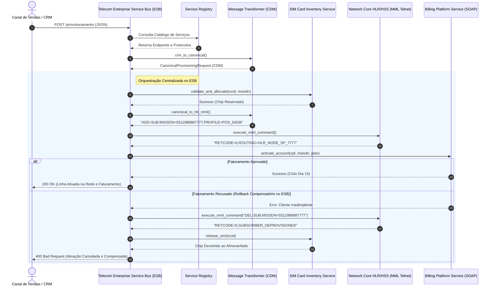

# Exemplo 02: Provisionamento de Telecomunicações via ESB (Telecom Provisioning ESB)

Este exemplo demonstra a **Service-Oriented Architecture (SOA)** na orquestração de ativação de linhas móveis 4G/5G em operadoras de telecomunicações, integrando sistemas heterogêneos de tecnologia comercial, física de rede e faturamento.

---

## 🎯 O Domínio do Problema

Em empresas de telecomunicações (Vivo, Claro, TIM):
1. **Sistemas Heterogêneos de Negócio:**
   - **CRM Comercial:** Capta a venda da linha e dados do assinante.
   - **Inventário de SIM Cards:** Controla o almoxarifado de chips físicos e identificadores únicos de chip (ICCID de 19 dígitos).
   - **Rede Celular Core (HLR / HSS):** Central telefônica de telecomunicação física que opera via comandos legados MML (*Man-Machine Language*) para roteamento em antenas.
   - **Billing Platform:** Motor corporativo de tarifação que cria a conta e define o ciclo de vencimento.
2. **Canonical Data Model (CDM):** O ESB normaliza pedidos heterogêneos de ativação em `CanonicalProvisioningRequest`.
3. **Orquestração e Compensação Transacional (Saga no ESB):** Se o faturamento (Billing) recusar o cliente (ex: restrição cadastral de crédito), o ESB executa a compensação automática: comanda o desprovisionamento da linha na rede celular (`DEL-SUB` no HLR) e devolve o chip físico para o estoque no almoxarifado, garantindo a integridade dos ativos corporativos.

---

## 🏛️ Diagrama de Arquitetura SOA (Mermaid)



---

## 📁 Estrutura de Pastas

```
02-telecom-provisioning-esb/
├── canonical/
│   ├── __init__.py
│   └── provisioning_models.py
├── esb/
│   ├── __init__.py
│   ├── service_registry.py
│   ├── message_transformer.py
│   └── bus_orchestrator.py
├── services/
│   ├── __init__.py
│   ├── sim_inventory_service.py
│   ├── network_hlr_service.py
│   └── billing_platform_service.py
├── main.py
└── README.md
```

---

## 🚀 Como Executar

Execute o comando a partir do diretório raiz:

```bash
python3 09-soa-service-oriented/02-telecom-provisioning-esb/main.py
```

### Cenários Validados no Teste:
1. **Ativação Regular Completa:** Validação e reserva do chip no estoque, provisionamento MML no HLR de rede móvel, ativação de fatura e retorno do código de roteamento.
2. **Rejeição por Chip Inexistente:** Bloqueio imediato na primeira etapa sem onerar a rede telefônica.
3. **Compensação Transacional Automática:** Quando o cliente possui pendência financeira no Billing, o ESB remove o registro da antena HLR e devolve o chip ao estoque físico.
