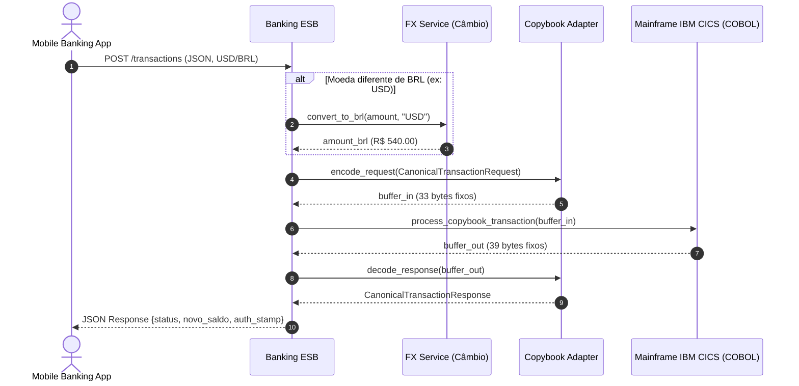

# 03 - Banking Core Mainframe Adapter (SOA ESB)

Este exemplo demonstra a aplicação da **Arquitetura Orientada a Serviços (SOA)** no setor bancário, integrando canais digitais modernos (Mobile Banking, JSON, REST) ao **Core Bancário Legado IBM z/OS CICS** programado em **COBOL**.

---

## 1. O Desafio Arquitetural

Em grandes instituições financeiras, o ledger contábil definitivo reside em mainframes legados operando há décadas. 
- Canais modernos comunicam-se via HTTP, JSON, payloads dinâmicos e moedas estrangeiras (USD, EUR).
- O Mainframe legado CICS/COBOL aceita apenas buffers fixos posicionais binários/EBCDIC (**COBOL Copybooks**) de tamanho fixo em centavos de Real (BRL).
- Conectar diretamente centenas de canais ao mainframe gera acoplamento tecnológico destrutivo e risco operacional.

---

## 2. Solução via SOA e Barramento Corporativo (ESB)

O **Enterprise Service Bus (ESB)** atua como a camada mediadora inteligente:
1. **Padronização via Canonical Data Model (CDM):** Converte a chamada externa para `CanonicalTransactionRequest`.
2. **Mediação e Câmbio de Moeda:** Se a requisição contiver moeda estrangeira (`USD`, `EUR`), invoca de forma autônoma o `ForeignExchangeService (FX)` para cotar e converter para BRL.
3. **Protocol & Message Adaptation:** O `MainframeCopybookAdapter` serializa o modelo canônico no layout posicional exato de **33 caracteres**:
   - `00-09`: TX-ID (PIC X(10))
   - `10-13`: AGENCIA (PIC 9(4))
   - `14-20`: CONTA (PIC 9(7))
   - `21-31`: VALOR-CENTAVOS (PIC 9(11))
   - `32-32`: TIPO-TRANSACAO (PIC X(1) - 'D' ou 'C')
4. **Execução no Mainframe CICS:** O core processa a transação e devolve um buffer fixo de **39 caracteres**:
   - `00-09`: TX-ID (PIC X(10))
   - `10-11`: RETURN-CODE (PIC 9(2)) — `00` (Sucesso), `51` (Saldo Insuficiente), `14` (Conta Inexistente)
   - `12-22`: NOVO-SALDO-CENTAVOS (PIC 9(11))
   - `23-38`: AUTH-STAMP (PIC X(16))
5. **Decodificação e Resposta Canônica:** O adapter reconverte o buffer em um objeto padronizado `CanonicalTransactionResponse`.

---

## 3. Diagrama de Sequência (Mermaid)



---

## 4. Estrutura de Pastas

```
03-banking-core-mainframe-adapter/
├── canonical/
│   ├── __init__.py
│   └── banking_models.py      # Modelo Canônico de Dados (CDM)
├── esb/
│   ├── __init__.py
│   ├── banking_esb.py         # Orquestrador do Barramento Corporativo
│   └── copybook_adapter.py    # Serializador/Desserializador de buffers posicionais
├── mainframe_core/
│   ├── __init__.py
│   └── mainframe_ledger.py    # Simulador CICS/COBOL com ledger contábil
├── services/
│   ├── __init__.py
│   └── currency_exchange_service.py # Serviço Corporativo de Câmbio (FX)
├── main.py                    # Cenários executáveis de teste
└── README.md
```

---

## 5. Como Executar

```bash
python3 main.py
```
Zero dependências externas necessárias (utiliza apenas Python 3 standard library).
