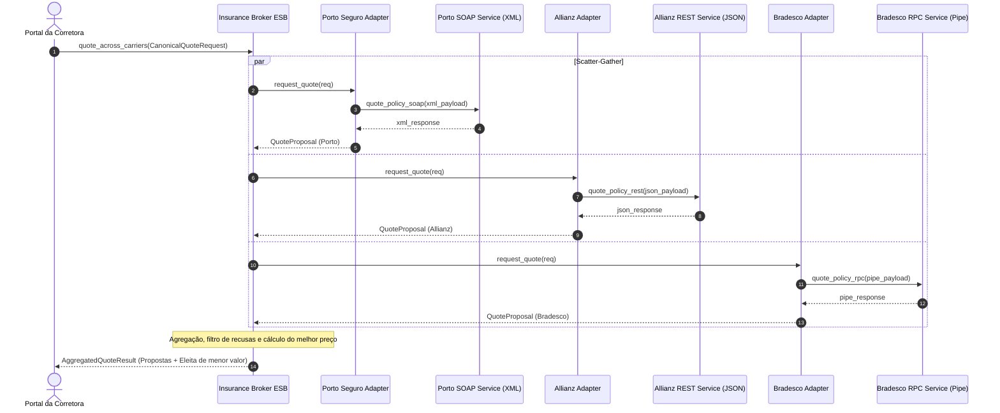

# 04 - Insurance Multi-Provider Underwriting (SOA ESB)

Este exemplo demonstra a aplicação da **Arquitetura Orientada a Serviços (SOA)** no setor de seguros, onde uma corretora/agregadora digital consome múltiplos parceiros de subscrição de apólices com interfaces e protocolos completamente heterogêneos.

---

## 1. O Desafio Arquitetural

Uma plataforma de comparação e contratação de seguros precisa consultar várias seguradoras simultaneamente:
- **Porto Seguro:** Expõe interface legada **SOAP / XML**.
- **Allianz:** Expõe interface moderna **REST / JSON**.
- **Bradesco Seguros:** Expõe interface legada **RPC via Socket com strings delimitadas por pipe (`|`)**.

Sem SOA:
- O cliente frontal precisaria conhecer todos os formatos de dados, endpoints e peculiaridades de protocolo de cada seguradora ($O(N)$ acoplamentos diretos).
- Falhas em um único parceiro travariam a cotação inteira do usuário.

---

## 2. Solução via SOA e Barramento Corporativo (ESB)

1. **Canonical Data Model (CDM):** Uma única estrutura uniforme `CanonicalQuoteRequest` define os dados do veículo, condutor e cobertura.
2. **Padrão EIP Scatter-Gather:**
   - O barramento (`InsuranceBrokerESB`) dispara chamadas paralelas/distribuídas para todos os adaptadores de provedores cadastrados.
3. **Adaptação de Protocolo e Formato (Adapter Pattern):**
   - `PortoSeguroAdapter`: Gera XML SOAP e consome XML.
   - `AllianzAdapter`: Serializa e consome JSON REST.
   - `BradescoAdapter`: Codifica e decodifica formato delimitado posicional.
4. **Tolerância a Falhas e Resiliência (Service Autonomy):**
   - Cada seguradora possui suas próprias regras de aceitação de risco (e.g., idade mínima, valor teto de veículo, idade máxima do carro).
   - O barramento isola recusas e falhas de serviços individuais, permitindo que as cotações bem-sucedidas continuem sendo agregadas e entregues ao cliente.
5. **Agregação e EIP Content-Based Aggregation:**
   - O ESB compila as respostas normalizadas em `AggregatedQuoteResult` e elege a proposta mais competitiva (menor prêmio anual).

---

## 3. Diagrama de Sequência (Mermaid)



---

## 4. Estrutura de Pastas

```
04-insurance-multiprovider-underwriting/
├── canonical/
│   ├── __init__.py
│   └── underwriting_models.py # Modelo Canônico de Dados (CDM)
├── providers/
│   ├── __init__.py
│   ├── porto_seguro_provider.py # Provedor SOAP/XML
│   ├── allianz_provider.py      # Provedor REST/JSON
│   └── bradesco_provider.py     # Provedor RPC Pipe-Delimited
├── esb/
│   ├── __init__.py
│   ├── insurance_broker_esb.py  # Orquestrador Scatter-Gather do ESB
│   └── adapters/
│       ├── __init__.py
│       ├── porto_adapter.py     # Adaptador XML
│       ├── allianz_adapter.py   # Adaptador JSON
│       └── bradesco_adapter.py  # Adaptador Delimitado
├── main.py                      # Cenários executáveis
└── README.md
```

---

## 5. Como Executar

```bash
python3 main.py
```
Zero dependências externas necessárias (utiliza apenas Python 3 standard library).
