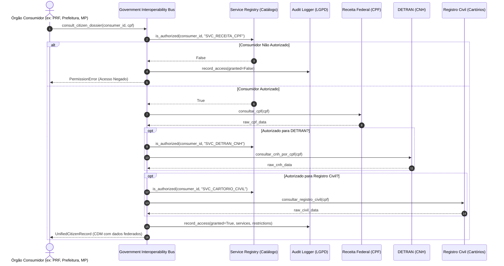

# 05 - Government Interoperability Bus (SOA ESB)

Este exemplo demonstra a aplicação da **Arquitetura Orientada a Serviços (SOA)** no setor público, inspirado em padrões corporativos governamentais como **e-PING (Padrões de Interoperabilidade de Governo Eletrônico)**, **X-Road** e **Gov.br**.

---

## 1. O Desafio Arquitetural

Em grandes estruturas governamentais, bases de dados essenciais residem em órgãos e autarquias juridicamente autônomos:
- **Receita Federal do Brasil:** Base autoritativa do Cadastro de Pessoas Físicas (CPF).
- **DETRAN:** Base autoritativa de Carteira Nacional de Habilitação (CNH) e infrações de trânsito.
- **Registro Civil / Cartórios:** Base de certidões civis (nascimento, casamento, divórcio).

Desafios:
1. **Silos e Duplicação:** Órgãos municipais e policiais historicamente duplicavam dados ou criavam integrações ponto a ponto vulneráveis.
2. **Privacidade e LGPD:** Nem todo órgão possui autorização legal para visualizar todas as informações de um cidadão (ex: uma Prefeitura não deve acessar pontos de CNH de trânsito ou histórico de divórcio em cartório).
3. **Auditoria Obrigatória:** Toda consulta a dados pessoais de cidadãos deve ser registrada com data, órgão solicitante e finalidade.

---

## 2. Solução via SOA e Barramento Governamental (ESB)

1. **Service Registry & Metadata (Catálogo de Serviços e Governança SOA):**
   - Centraliza o cadastro dos contratos de serviços, versões, órgãos mantenedores e perfis de segurança requeridos.
2. **Canonical Data Model (CDM):**
   - O barramento padroniza o retorno através do `UnifiedCitizenRecord`, agregando `TaxIdentificationRecord`, `DriverLicenseRecord` e `CivilRegistryRecord`.
3. **Policy Enforcement & Autorização Granular:**
   - O barramento verifica os papéis do órgão consumidor. Se o consumidor tiver apenas autorização básica (ex: `PREFEITURA_CAMPINAS`), os blocos de trânsito e cartório são omitidos de forma segura.
   - Órgãos com prerrogativa máxima (ex: `MINISTERIO_PUBLICO`) recebem o dossiê federado completo.
4. **Audit Logger e Conformidade LGPD:**
   - O barramento registra todas as tentativas de consulta (concedidas e negadas) de forma imutável.

---

## 3. Diagrama de Sequência (Mermaid)



---

## 4. Estrutura de Pastas

```
05-government-interoperability-bus/
├── canonical/
│   ├── __init__.py
│   └── citizen_models.py          # Modelo Canônico do Cidadão (CDM)
├── government_organs/
│   ├── __init__.py
│   ├── receita_federal_service.py # Serviço Autoritativo de CPF
│   ├── detran_service.py          # Serviço Autoritativo de CNH
│   └── cartorio_civil_service.py  # Serviço Autoritativo de Cartórios
├── esb/
│   ├── __init__.py
│   ├── service_registry.py        # Catálogo central e perfis de governança
│   ├── audit_logger.py            # Trilha de auditoria e conformidade LGPD
│   └── interoperability_bus.py    # Orquestrador do Barramento
├── main.py                        # Cenários executáveis
└── README.md
```

---

## 5. Como Executar

```bash
python3 main.py
```
Zero dependências externas necessárias (utiliza apenas Python 3 standard library).
