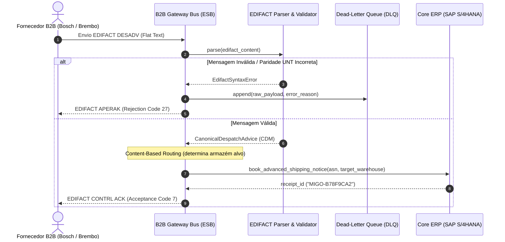

# 06 - Supply Chain EDI B2B Gateway (SOA ESB)

Este exemplo demonstra a aplicação da **Arquitetura Orientada a Serviços (SOA)** na cadeia de suprimentos da indústria automotiva e manufatura pesada, conectando fornecedores globais via **UN/EDIFACT (DESADV)** ao **Core ERP corporativo (SAP S/4HANA)**.

---

## 1. O Desafio Arquitetural

Grandes montadoras (ex: Volkswagen, Stellantis, Embraer) operam em rede com milhares de fornecedores (*Tier-1 suppliers* como Bosch, Continental, Brembo):
- **Fornecedores Externos:** Transmitem avisos de expedição e notas fiscais eletrônicas em padrões internacionais legados de EDI (*Electronic Data Interchange*), principalmente **UN/EDIFACT DESADV** ou ANSI X12.
- **Sistemas Internos:** O ERP corporativo (SAP, Oracle) e os sistemas de armazém (WMS) operam com APIs REST/JSON ou IDocs específicos.
- Conectar diretamente fornecedores aos bancos de dados do ERP criaria vulnerabilidades de segurança, incompatibilidade de formatos e ausência de roteamento inteligente de mercadorias.

---

## 2. Solução via SOA e Gateway B2B no Barramento (ESB)

1. **Protocol and Message Transformation:**
   - O `EdifactDesadvParser` processa fluxos posicionais delimitados por apóstrofo (`'`) e mais (`+`), convertendo segmentos (`BGM`, `DTM`, `NAD`, `LIN`, `QTY`, `UNT`) no **Canonical Data Model (CDM)**: `CanonicalDespatchAdvice`.
2. **Validação de Conformidade e Integridade:**
   - O barramento valida a paridade de contagem de segmentos declarada no trailer `UNT`. Mensagens corrompidas ou adulteradas são imediatamente rejeitadas.
3. **Dead-Letter Queue (DLQ):**
   - Mensagens com falha de sintaxe ou violação de contrato são isoladas em uma DLQ para conciliação por operadores B2B, sem interromper o tráfego regular.
4. **Content-Based Routing (Roteamento Baseado em Conteúdo):**
   - O barramento inspeciona as peças da remessa (`part_number`):
     - Peças de motor/injeção (`INJ-`) são roteadas para o armazém `W-POWERTRAIN-01`.
     - Peças de freio/suspensão (`BRK-`) são roteadas para o armazém `W-CHASSIS-02`.
5. **Geração Automática de Confirmação B2B (CONTRL / APERAK):**
   - O barramento gera a resposta EDIFACT padronizada notificando o parceiro comercial sobre o aceite ou recusa da remessa.

---

## 3. Diagrama de Sequência (Mermaid)



---

## 4. Estrutura de Pastas

```
06-supply-chain-edi-b2b-gateway/
├── canonical/
│   ├── __init__.py
│   └── supply_chain_models.py # Modelo Canônico de Despacho (CDM)
├── erp_core/
│   ├── __init__.py
│   └── warehouse_erp_service.py # Core ERP / WMS Corporativo
├── esb/
│   ├── __init__.py
│   ├── edifact_parser.py      # Parser e validador UN/EDIFACT
│   └── edi_b2b_gateway.py     # Gateway B2B, Content Routing e DLQ
├── main.py                    # Cenários executáveis
└── README.md
```

---

## 5. Como Executar

```bash
python3 main.py
```
Zero dependências externas necessárias (utiliza apenas Python 3 standard library).
