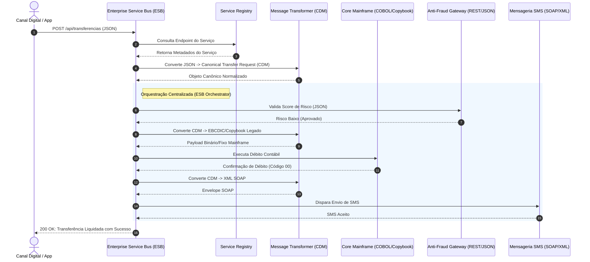

# 🏢 Service-Oriented Architecture (SOA - Arquitetura Orientada a Serviços)

> *"Services are autonomous, loosely coupled software components with well-defined, standardized interfaces that can be discovered and orchestrated to fulfill enterprise business processes."*  
> — **Thomas Erl (Service-Oriented Architecture: Concepts, Technology, and Design)**

---

## 📖 1. O que é e Origem Histórica

A **Service-Oriented Architecture (SOA)** é um paradigma arquitetural corporativo concebido no início dos anos 2000 (padronizado pela **OASIS** e amplamente documentado por **Thomas Erl**) para solucionar o maior desafio das grandes empresas da época: **a fragmentação e o isolamento de sistemas legados heterogêneos (silos de dados)**.

Grandes corporações (bancos, companhias aéreas, telecomunicações e governos) possuíam dezenas de sistemas legados em plataformas incompatíveis: mainframes IBM, bancos de dados Oracle, sistemas em COBOL, SAP ERP, CRMs legados e novas aplicações Web. 

Antes de SOA, essas integrações eram feitas ponto a ponto (*spaghetti integrations*): cada novo sistema exigia conectores ad-hoc para todos os outros, criando uma malha de dependências inquebrável.

SOA introduziu uma abordagem revolucionária:
1. **Serviços de Negócio Reutilizáveis:** Em vez de expor bancos de dados, os sistemas expõem *serviços* orientados a capacidades de negócio corporativas (ex: *VerificarCrédito*, *EmitirBilheteAéreo*, *AtivarLinha*).
2. **Contratos Padronizados e Canônicos:** Contratos formais e agnósticos de tecnologia (historicamente WSDL/SOAP/XML, hoje também OpenAPI/JSON).
3. **Barramento de Serviços Corporativo (Enterprise Service Bus - ESB):** Uma espinha dorsal de infraestrutura responsável por roteamento inteligente, transformação de mensagens e mediação de protocolos.

---

## 🏛️ 2. Os 8 Princípios Fundamentais de Thomas Erl

Toda arquitetura SOA legítima baseia-se nos seguintes 8 princípios canônicos:

```
┌────────────────────────────────────────────────────────────────────────┐
│                        OS 8 PRINCÍPIOS DE SOA                          │
│                                                                        │
│ 1. Contrato Padronizado  ──────► Define assinaturas formais e schemas   │
│ 2. Fraco Acoplamento     ──────► Reduz dependências mútuas e detalhes   │
│ 3. Abstração             ──────► Oculta a tecnologia interna (COBOL/DB)│
│ 4. Reutilização          ──────► Projetado para múltiplos consumidores  │
│ 5. Autonomia             ──────► Controla sua própria execução e lógica │
│ 6. Statelessness         ──────► Minimiza retenção de estado de sessão  │
│ 7. Descobrabilidade      ──────► Localizável em Service Catalog/Registry│
│ 8. Componibilidade       ──────► Pode ser orquestrado em macroprocessos │
└────────────────────────────────────────────────────────────────────────┘
```

---

## 🔄 3. O Enterprise Service Bus (ESB) e o Modelo de Dados Canônico (CDM)

O **ESB** é o coração da arquitetura SOA tradicional:

```
┌───────────────────────────────────────────────────────────────────────────────┐
│                        ENTERPRISE SERVICE BUS (ESB)                           │
│                                                                               │
│  [ Canal Mobile ]  [ Portal Web ]  [ Parceiro B2B ]  [ Sistema de Caixa ]     │
│         │                 │               │                 │                 │
│         ▼                 ▼               ▼                 ▼                 │
│  ───────┬─────────────────┬───────────────┬─────────────────┬───────────────  │
│         │ JSON/REST       │ SOAP/XML      │ EDI / FlatFile  │ RPC             │
│         ▼                 ▼               ▼                 ▼                 │
│    ┌─────────────────────────────────────────────────────────────┐            │
│    │               TRANSFORMAÇÃO PARA O MODELO                   │            │
│    │               DE DADOS CANÔNICO (CDM)                       │            │
│    │           Canonical Data Model (Ex: `Customer`, `Order`)    │            │
│    └──────────────────────────────┬──────────────────────────────┘            │
│                                   │                                           │
│    ┌──────────────────────────────▼──────────────────────────────┐            │
│    │               ROTEAMENTO BASEADO EM CONTEÚDO                │            │
│    │                 (Content-Based Routing)                     │            │
│    └──────────────────────────────┬──────────────────────────────┘            │
│                                   │                                           │
│    ┌──────────────────────────────▼──────────────────────────────┐            │
│    │               ORQUESTRAÇÃO DO PROCESSO (BPEL)               │            │
│    │  (Chama Serviço A ──► Valida com B ──► Grava no Mainframe C)│            │
│    └──────────────────────────────┬──────────────────────────────┘            │
│  ───────┬─────────────────────────┼─────────────────────────┬───────────────  │
│         ▼                         ▼                         ▼                 │
│  [ Mainframe COBOL ]      [ SAP ERP Legacy ]        [ CRM Salesforce ]        │
└───────────────────────────────────────────────────────────────────────────────┘
```

### O que é o Canonical Data Model (CDM)?
Sem o CDM, se uma empresa possui 10 sistemas, precisará de até $10 \times (10 - 1) = 90$ transformadores de mensagem. Com o CDM, cada sistema só precisa de **dois transformadores**:
- De seu formato proprietário $\rightarrow$ para o formato Canônico corporativo.
- Do formato Canônico corporativo $\rightarrow$ para seu formato proprietário.
Reduzindo a complexidade de $O(N^2)$ para $O(2N)$.

---

## ⚖️ 4. Matriz Crítica: SOA vs Microservices

Embora Microsserviços sejam frequentemente chamados de "SOA bem-sucedido" ou "SOA fino", existem distinções conceituais profundas:

| Dimensão | Service-Oriented Architecture (SOA) | Microservices Architecture |
|---|---|---|
| **Escopo Arquitetural** | **Corporativo / Enterprise-wide** (abrange toda a corporação e sistemas legados). | **Escopo de Aplicação / Produto** (times ágeis de produto). |
| **Padrão de Comunicação** | **Barramento Inteligente (Smart Pipes):** O ESB transforma mensagens, orquestra e faz mediação. | **Tubos Burros, Terminais Inteligentes (Dumb Pipes, Smart Endpoints):** HTTP/gRPC/Kafka sem inteligência no meio. |
| **Modelo de Dados** | **Canonical Data Model (CDM):** Busca unificar schemas corporativos compartilhados. | **Database-per-Service:** Descentralização total de dados; Bounded Contexts sem schema canônico global. |
| **Governança** | **Centralizada:** Comitê de arquitetura corporativa, catálogos de serviços rigorosos. | **Descentralizada:** Times têm autonomia de stack, deploy e banco. |
| **Objetivo Primário** | **Reutilização e Integração:** Reaproveitar sistemas legados e evitar silos. | **Velocidade e Desacoplamento de Deploy:** Entregar features independentemente. |

---

## 📐 5. Diagramas Conceituais (Mermaid)

### Orquestração de Negócio via ESB com Mediação de Protocolos



---

## 🚫 6. Regras Invariantes (O que NUNCA Fazer em SOA)

| Invariante | Por que Viola SOA? | O que Fazer no Lugar? |
|---|---|---|
| **❌ Integração Ponto a Ponto sem Contrato Canônico** | Recria o problema da teia de aranha legada impossível de manter. | Todas as integrações corporativas devem passar pelo contrato canônico ou adaptador do serviço. |
| **❌ Serviços Stateful com retenção de sessão no ESB** | Destrói a escalabilidade do barramento e cria afinidade de servidor. | Serviços devem ser estritamente *stateless*; qualquer contexto é passado no envelope da mensagem. |
| **❌ Vazar modelos internos do banco de um legado para outros consumidores** | Quebra a abstração; qualquer alteração no legado quebra toda a empresa. | Expor exclusivamente o DTO definido no contrato formal do serviço. |
| **❌ Colocar lógica de negócio densa dentro do ESB** | Transforma o ESB em um monólito gigante e opaco (*fat ESB antipattern*). | O ESB orquestra e medeia protocolos; a regra de negócio vive nos serviços participantes. |

---

## 📂 7. Catálogo dos 6 Exemplos Práticos Implementados

| # | Exemplo | Domínio & Serviços Integrados | Mecanismos Chave de SOA |
|---|---|---|---|
| **01** | [`01-airline-booking-gds-integration`](./01-airline-booking-gds-integration/) | GDS Amadeus/Sabre, Pagamento, Emissão de Bilhetes | Barramento ESB com Canonical Model, Protocol Translation (Legacy EDIFACT/Text $\rightarrow$ REST). |
| **02** | [`02-telecom-provisioning-esb`](./02-telecom-provisioning-esb/) | CRM Comercial, HLR/HSS de Rede, Faturamento, Inventário | Orquestração de ativação de SIM card/Linha Móvel via ESB com rollback compensatório. |
| **03** | [`03-banking-core-mainframe-adapter`](./03-banking-core-mainframe-adapter/) | Mobile Banking, Core Bancário Mainframe, Câmbio | Adaptador de mensagens Copybook/Fixed-Width para JSON via Message Broker e Canonical Transaction. |
| **04** | [`04-insurance-multiprovider-underwriting`](./04-insurance-multiprovider-underwriting/) | Seguradora Alpha, Beta e Gamma (Schemas distintos) | Content-Based Routing e normalização de propostas de apólice via barramento corporativo. |
| **05** | [`05-government-interoperability-bus`](./05-government-interoperability-bus/) | Receita Federal (CPF), DETRAN (CNH), Cartório (Certidões) | Barramento Cidadão de Interoperabilidade com Service Registry e segurança de contratos. |
| **06** | [`06-supply-chain-edi-b2b-gateway`](./06-supply-chain-edi-b2b-gateway/) | Montadora Automotiva, Fornecedores Tier-1 e Tier-2 | Tradução bidirecional de ordens de entrega EDIFACT $\leftrightarrow$ XML $\leftrightarrow$ JSON. |
