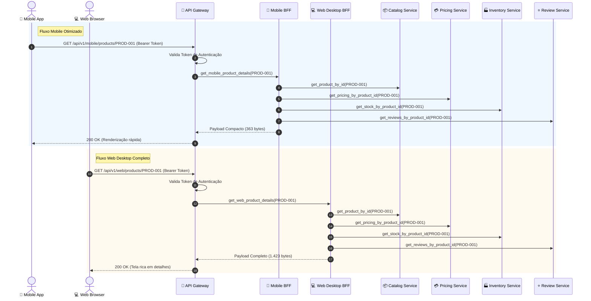

# 01 - E-Commerce API Gateway & Backend-for-Frontend (BFF)

Este exemplo demonstra os padrões essenciais de borda em microsserviços: **API Gateway** e **Backend-for-Frontend (BFF)**, orquestrando a Página de Detalhes do Produto (*Product Details Page - PDP*) em um ecossistema de comércio eletrônico.

---

## 1. O Desafio Arquitetural

Em uma arquitetura de microsserviços madura, uma única tela do usuário (ex: PDP de um smartphone) requer dados espalhados em vários domínios autônomos:
- **Catalog Service:** Título, especificações técnicas, descrições e galeria de fotos.
- **Pricing Service:** Preço de tabela, promoções vigentes e cálculo de parcelamento.
- **Inventory Service:** Disponibilidade física em estoque, centros de distribuição e prazo de frete (ETA).
- **Review Service:** Média de estrelas, total de avaliações e comentários de compradores.

### O problema de expor microsserviços diretamente aos clientes:
1. **Chatty Communication (Cliente Tagarela):** O navegador ou aplicativo mobile precisaria realizar 4 requisições HTTP distintas para montar uma única tela, multiplicando a latência de rede.
2. **Excesso de Dados (Over-fetching) no Mobile:** Smartphones com conectividade 4G/5G não necessitam do JSON completo com dezenas de especificações técnicas ou comentários longos na primeira renderização.
3. **Falta de Segurança & Acoplamento:** Clientes externos conheceriam IPs, portas e a topologia interna de cada microsserviço.

---

## 2. Solução via API Gateway e BFF

1. **API Gateway Único:**
   - Atua como ponto único de entrada (*Single Point of Ingress*).
   - Valida autenticação (tokens Bearer) centralizadamente antes de repassar qualquer carga aos serviços internos.
   - Mascara a rede interna.
2. **Backend-for-Frontend (BFF) Pattern:**
   - **Mobile BFF:** Agrega as 4 fontes e produz um JSON ultra-compacto (**~74% de economia de bytes**), otimizando a bateria do dispositivo e o consumo de dados móveis.
   - **Web Desktop BFF:** Agrega as 4 fontes e entrega a árvore completa com galeria multimídia em alta resolução, tabela de parcelamento e resenhas detalhadas.
3. **Database-per-Service:**
   - Cada um dos 4 microsserviços (`Catalog`, `Pricing`, `Inventory`, `Review`) opera com sua própria persistência independente.

---

## 3. Diagrama de Arquitetura e Sequência (Mermaid)



---

## 4. Estrutura de Pastas

```
01-ecommerce-api-gateway-bff/
├── services/
│   ├── __init__.py
│   ├── catalog_service.py     # Microsserviço de Catálogo (DB próprio)
│   ├── pricing_service.py     # Microsserviço de Preços (DB próprio)
│   ├── inventory_service.py   # Microsserviço de Estoque (DB próprio)
│   └── review_service.py      # Microsserviço de Avaliações (DB próprio)
├── gateway/
│   ├── __init__.py
│   ├── mobile_bff.py          # BFF otimizado para dispositivos móveis
│   ├── web_desktop_bff.py     # BFF para portais Web Desktop
│   └── api_gateway.py         # Gateway reverso com autenticação e métricas
├── main.py                    # Cenários de teste executáveis
└── README.md
```

---

## 5. Como Executar

```bash
python3 main.py
```
Zero dependências externas necessárias (utiliza apenas Python 3 standard library).
