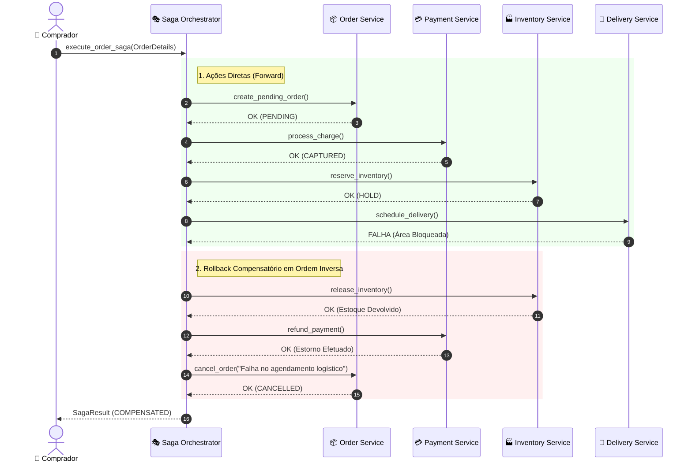

# 02 - Order Saga Orchestrator (Transações Distribuídas em Microsserviços)

Este exemplo demonstra a implementação do padrão **Saga Orquestrada (Orchestrated Saga Pattern)** para gerenciar transações distribuídas e garantir consistência eventual (*Eventual Consistency*) entre microsserviços autônomos sem bloqueios transacionais de duas fases (2PC).

---

## 1. O Desafio Arquitetural

Em microsserviços, cada serviço possui seu próprio banco de dados (*Database-per-Service*):
- `OrderService` possui a tabela de pedidos.
- `PaymentService` possui os registros de cobrança e gateways de cartão.
- `InventoryService` possui o saldo de estoque físico.
- `DeliveryService` possui os agendamentos com transportadoras.

### Por que o 2PC (Two-Phase Commit) é inviável em Microsserviços?
1. **Acoplamento Temporal e Locks Bloqueantes:** O 2PC bloqueia linhas de banco durante a fase de preparação (*Prepare phase*). Se a rede engasgar ou um serviço demorar, todas as tabelas participantes travam.
2. **Violação do Teorema CAP:** Em caso de partição de rede (*Network Partition*), o 2PC sacrifica totalmente a disponibilidade (*Availability*).
3. **Incompatibilidade Tecnológica:** Serviços podem usar PostgreSQL, MongoDB, DynamoDB ou Redis, tornando transações XA impossíveis.

---

## 2. Solução via Saga Orquestrada

A **Saga** quebra a transação global em uma série de transações locais sequenciais:
1. **Ações Diretas (*Forward Actions*):** Cada microsserviço executa sua transação local no seu próprio banco e atualiza seu estado.
2. **Máquina de Estados Central (*Orchestrator*):** O `OrderSagaOrchestrator` decide qual é o próximo passo e monitora o sucesso ou a falha de cada chamada.
3. **Transações Compensatórias (*Compensating Transactions*):** Se qualquer etapa falhar no meio do caminho, o orquestrador executa ações compensatórias na **ordem estritamente inversa**, desfazendo os efeitos colaterais anteriores e garantindo a integridade do sistema.

### Matriz de Passos e Compensações

| Etapa | Microsserviço | Ação Direta (*Forward*) | Ação Compensatória (*Compensate*) |
|---|---|---|---|
| **1** | `OrderService` | `create_pending_order()` | `cancel_order(reason)` |
| **2** | `PaymentService` | `process_charge()` | `refund_payment(payment_id)` |
| **3** | `InventoryService` | `reserve_inventory()` | `release_inventory(reservation_id)` |
| **4** | `DeliveryService` | `schedule_delivery()` | `cancel_delivery(dispatch_id)` |

---

## 3. Diagrama de Sequência e Rollback Compensatório (Mermaid)



---

## 4. Estrutura de Pastas

```
02-order-saga-orchestrator/
├── saga/
│   ├── __init__.py
│   ├── saga_models.py           # Modelos de dados e enums de estado
│   └── order_saga_orchestrator.py # Máquina de estados da Saga e compensações
├── services/
│   ├── __init__.py
│   ├── order_service.py         # Microsserviço de Pedidos (DB próprio)
│   ├── payment_service.py       # Microsserviço de Pagamentos (DB próprio)
│   ├── inventory_service.py     # Microsserviço de Estoque (DB próprio)
│   └── delivery_service.py      # Microsserviço de Logística (DB próprio)
├── main.py                      # Cenários de teste executáveis
└── README.md
```

---

## 5. Como Executar

```bash
python3 main.py
```
Zero dependências externas necessárias (utiliza apenas Python 3 standard library).
