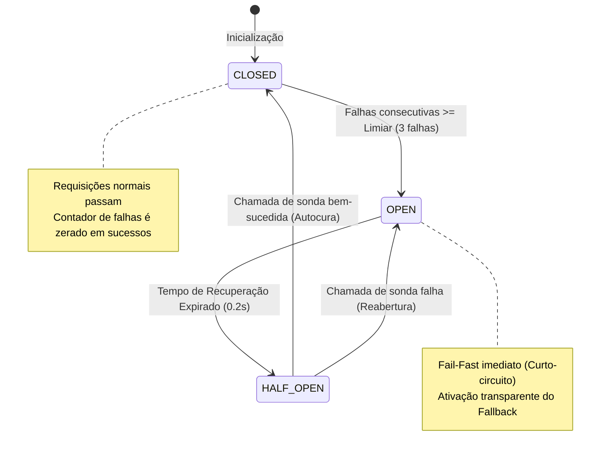

# 03 - Resilience: Circuit Breaker & Fallback (Hystrix / Resilience4j Pattern)

Este exemplo demonstra a implementação do padrão **Circuit Breaker** com mecanismo de **Fallback degradado**, protegendo microsserviços contra falhas em cascata e latências destrutivas em redes distribuídas.

---

## 1. O Desafio Arquitetural

Em sistemas distribuídos, microsserviços dependem constantemente de outros serviços através da rede.
- Suponha que o `RecommendationService` chame o `MachineLearningScoringService` para calcular recomendações por IA.
- Se o cluster de GPU de ML sofrer lentidão ou entrar em sobrecarga, chamadas subsequentes acumularão threads e conexões HTTP abertas no cliente.
- **Efeito Dominó (Cascading Failure):** O cliente esgota seu pool de threads, suas portas TCP e sua memória, quebrando toda a aplicação mesmo que as outras partes do sistema estejam sadias.

---

## 2. Solução via Circuit Breaker e Máquina de Estados

O **Circuit Breaker** (popularizado por Michael Nygard em *"Release It!"* e implementado por bibliotecas consagradas como *Netflix Hystrix* e *Resilience4j*) envolve as chamadas remotas em uma máquina de estados:

1. **CLOSED (Fechado - Operação Normal):**
   - Todas as requisições passam diretamente para o serviço remoto.
   - Um contador de falhas consecutivas monitora a saúde das respostas.
   - Se o número de falhas consecutivas atingir o limiar (`failure_threshold = 3`), o circuito desarma e transiciona para **OPEN**.
2. **OPEN (Aberto - Curto-circuito Fail-Fast):**
   - O circuito **não toca a rede**.
   - As requisições são rejeitadas instantaneamente com zero milissegundos de latência.
   - O cliente executa a estratégia de **Fallback** (ex: serve recomendações pré-calculadas de um cache estático), mantendo a experiência do usuário sem exibir erros 500.
   - Um temporizador de recuperação (`recovery_timeout_seconds`) inicia a contagem regressiva.
3. **HALF-OPEN (Meio-Aberto - Sonda de Recuperação):**
   - Após o timeout de recuperação, o circuito permite uma chamada de teste (*canary / probe call*).
   - Se a chamada obtiver sucesso, o circuito se autocura e volta para **CLOSED**.
   - Se a chamada falhar, o circuito retorna imediatamente para **OPEN** reiniciando o timer.

---

## 3. Diagrama da Máquina de Estados (Mermaid)



---

## 4. Estrutura de Pastas

```
03-resilience-circuit-breaker/
├── resilience/
│   ├── __init__.py
│   └── circuit_breaker.py         # Máquina de estados finita CLOSED/OPEN/HALF_OPEN
├── services/
│   ├── __init__.py
│   ├── ml_scoring_service.py      # Microsserviço de ML com simulador de instabilidade
│   └── recommendation_service.py  # Serviço cliente com Fallback e proteção de disjuntor
├── main.py                        # Ciclo completo de vida e telemetria
└── README.md
```

---

## 5. Como Executar

```bash
python3 main.py
```
Zero dependências externas necessárias (utiliza apenas Python 3 standard library).
