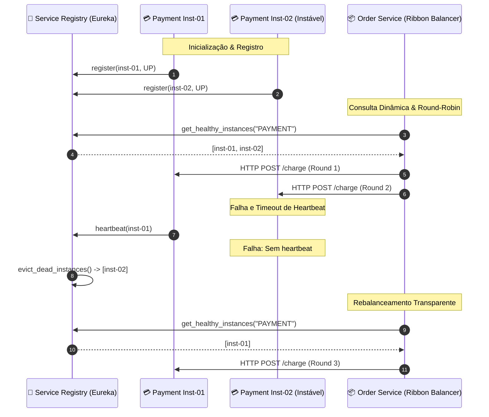

# 04 - Service Registry & Discovery com Client-Side Load Balancing

Este exemplo demonstra a implementação do padrão **Service Registry & Discovery** (estilo *Netflix Eureka* e *HashiCorp Consul*) acoplado ao padrão **Client-Side Load Balancing** (estilo *Netflix Ribbon*), permitindo que microsserviços se localizem e distribuam carga dinamicamente em ambientes com instâncias efêmeras.

---

## 1. O Desafio Arquitetural

Em ambientes modernos com contêineres e nuvem (Kubernetes, AWS ECS):
- Instâncias sobem, sofrem auto-scaling e são destruídas dinamicamente a cada minuto.
- Cada nova instância recebe um endereço IP e porta diferentes.
- **Por que IPs estáticos ou DNS tradicional falham?**
  1. O cache de DNS (TTL) é lento para propagar em nível de rede, gerando requisições enviadas para instâncias mortas.
  2. Load Balancers centrais adicionam saltos extras de rede (*network hops*), aumentando latência e criando um gargalo físico centralizado.

---

## 2. Solução via Service Registry & Client-Side Balancing

1. **Service Registry Dinâmico (Eureka/Consul):**
   - Atua como o catálogo telefônico vivo de instâncias.
   - Quando uma instância sobe, ela executa `register(instance)`.
   - **Heartbeats & Eviction:** A instância envia batimentos cardíacos periódicos. Se parar de responder dentro do limiar de tempo (`TTL`), o Registry realiza o *eviction* automático da instância morta.
2. **Client-Side Load Balancer (Ribbon):**
   - O próprio cliente de microsserviço (`OrderServiceClient`) consulta a lista de instâncias saudáveis no Registry.
   - Aplica algoritmos de balanceamento locais (como **Round-Robin**), distribuindo as chamadas uniformemente sem precisar de um proxy reverso central intermediário.
3. **Resiliência a Falhas:**
   - Se uma instância cair, as chamadas continuam sendo roteadas apenas para as instâncias ativas remanescentes de forma transparente.

---

## 3. Diagrama de Sequência e Topologia (Mermaid)



---

## 4. Estrutura de Pastas

```
04-service-registry-discovery/
├── discovery/
│   ├── __init__.py
│   ├── service_instance.py      # Metadados da instância (host, porta, status, TTL)
│   ├── service_registry.py      # Repositório dinâmico com heartbeats e evicção
│   └── load_balancer.py         # Balanceador Round-Robin no cliente
├── client/
│   ├── __init__.py
│   └── order_service_client.py  # Cliente consumidor com descoberta automática
├── main.py                      # Cenários de teste executáveis
└── README.md
```

---

## 5. Como Executar

```bash
python3 main.py
```
Zero dependências externas necessárias (utiliza apenas Python 3 standard library).
