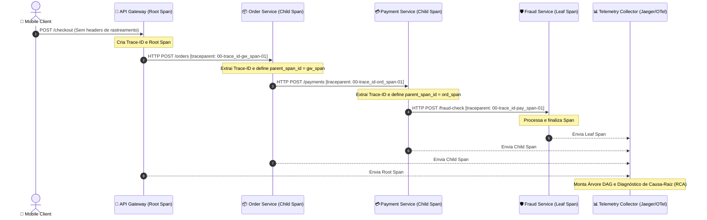

# 05 - Distributed Tracing & W3C TraceContext (OpenTelemetry / Jaeger Pattern)

Este exemplo demonstra a implementação de **Distributed Tracing (Rastreamento Distribuído)** e propagação de contexto em microsserviços utilizando a especificação formal do **W3C TraceContext** (`traceparent`).

---

## 1. O Desafio Arquitetural

Em sistemas distribuídos:
- Uma única chamada do usuário (ex: "Efetuar Checkout") atravessa múltiplos saltos de rede entre microsserviços:
  $$\text{API Gateway} \longrightarrow \text{Order Service} \longrightarrow \text{Payment Service} \longrightarrow \text{Fraud Detection}$$
- **O Desastre dos Logs Locais Desconectados:** Se uma chamada demorar 3 segundos ou lançar um erro 500 no serviço de fraude, inspecionar logs tradicionais isolados é quase impossível. Cada serviço gera milhares de linhas de log por segundo sem qualquer chave que os correlacione.

---

## 2. Solução via Distributed Tracing & W3C TraceContext

O padrão estabelecido pelo Google Dapper e consolidado no **OpenTelemetry** resolve isso através de um grafo acíclico direcionado (DAG) de **Spans**:

1. **Trace ID (`trace_id`):** Um identificador hexadecimal único de 128 bits gerado na borda (*API Gateway*) que acompanha a requisição por toda a sua jornada distribuída.
2. **Span ID (`span_id`):** Um identificador único de 64 bits para cada operação ou método individual em um microsserviço.
3. **Parent Span ID (`parent_span_id`):** Aponta para o span pai que originou a chamada remota, permitindo montar a árvore hierárquica (*Waterfall View*).
4. **Cabeçalho HTTP W3C `traceparent`:**
   ```
   traceparent: 00-{trace_id}-{span_id}-{flags}
   ```
   Injetado pelo cliente HTTP e extraído pelo servidor HTTP em cada salto da malha de microsserviços.

---

## 3. Diagrama em Cascata (Waterfall Tree)



---

## 4. Estrutura de Pastas

```
05-distributed-tracing-correlation/
├── tracing/
│   ├── __init__.py
│   ├── trace_context.py       # Manipulação de cabeçalhos W3C traceparent
│   └── tracer.py              # Instrumentação de spans e coletor em memória
├── services/
│   ├── __init__.py
│   ├── api_gateway.py         # Ponto de borda que inicia o Root Span
│   ├── order_service.py       # Microsserviço de Pedidos
│   ├── payment_service.py     # Microsserviço de Pagamentos
│   └── fraud_service.py       # Microsserviço de Detecção de Fraude
├── main.py                    # Cenários de sucesso e Root-Cause Analysis (RCA)
└── README.md
```

---

## 5. Como Executar

```bash
python3 main.py
```
Zero dependências externas necessárias (utiliza apenas Python 3 standard library).
