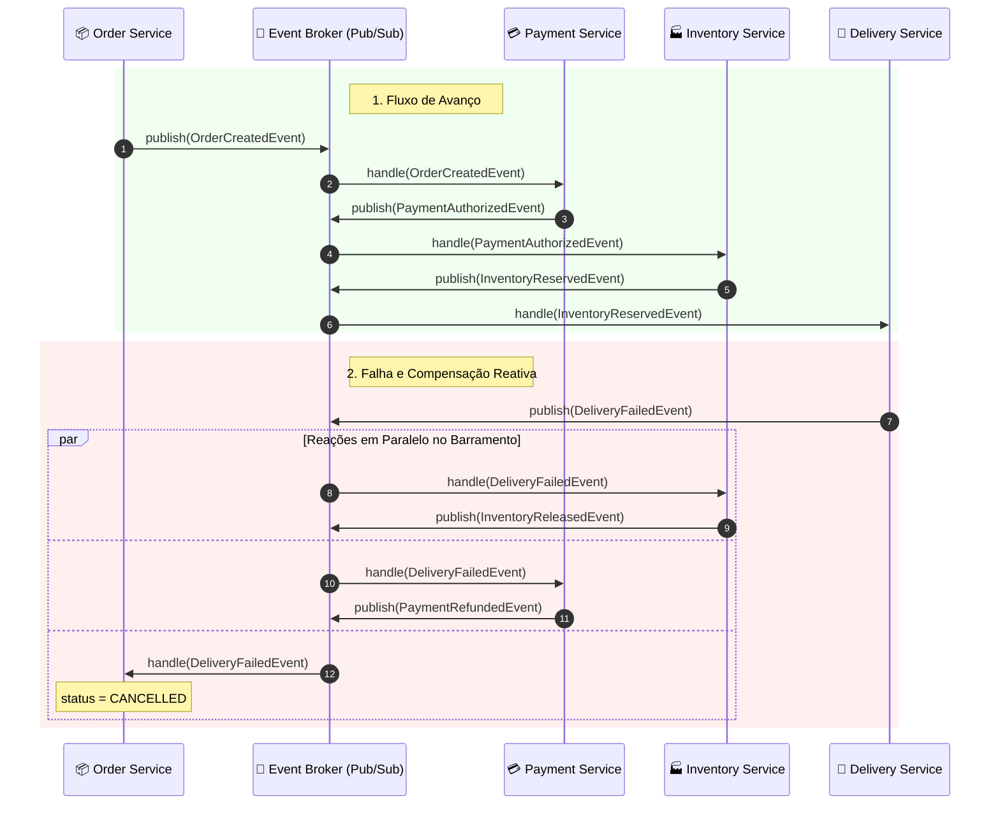

# 06 - Event-Driven Choreographed Saga (Saga Coreografada Reativa)

Este exemplo demonstra a implementação do padrão **Saga Coreografada (Choreographed Saga Pattern)** baseada em eventos de domínio assíncronos (*Domain Events*) sem qualquer coordenador ou orquestrador central.

---

## 1. O Desafio Arquitetural

No exemplo 02, exploramos a **Saga Orquestrada**, onde um orquestrador central decide a próxima ação imperativamente.
- Embora a orquestração seja fácil de monitorar, ela pode criar um ponto de centralização excessiva de lógica de fluxo (*Smart Orchestrator, Anemic Services*).
- Em sistemas de altíssimo throughput e desacoplamento radical (como plataformas de streaming e grandes varejistas orientados a Kafka/RabbitMQ), prefere-se a **Coreografia**.

### Como funciona a Coreografia?
- **Dança dos Serviços:** Como dançarinos em uma coreografia, nenhum participante recebe comandos de um maestro. Cada serviço sabe exatamente o que fazer ao ouvir uma nota musical específica (um evento de domínio).
- Não há acoplamento de APIs HTTP diretas entre os serviços. Todos publicam e consomem de um canal de mensageria assíncrono.

---

## 2. Solução via Eventos de Domínio e Compensação Reativa

1. **Avanço Direto (*Forward Choreography*):**
   - `OrderService` emite `OrderCreatedEvent`.
   - `PaymentService` escuta `OrderCreatedEvent`, cobra o cliente e emite `PaymentAuthorizedEvent`.
   - `InventoryService` escuta `PaymentAuthorizedEvent`, reserva estoque e emite `InventoryReservedEvent`.
   - `DeliveryService` escuta `InventoryReservedEvent`, agenda transportadora e emite `DeliveryScheduledEvent`.
   - `OrderService` escuta `DeliveryScheduledEvent` e marca o pedido como `CONFIRMED`.
2. **Compensação Reativa (*Compensating Choreography*):**
   - Se o `DeliveryService` falhar (ex: CEP bloqueado), ele publica `DeliveryFailedEvent`.
   - `InventoryService` reage ao `DeliveryFailedEvent`, desfaz a reserva de estoque e publica `InventoryReleasedEvent`.
   - `PaymentService` reage ao `DeliveryFailedEvent`, estorna a cobrança e publica `PaymentRefundedEvent`.
   - `OrderService` reage a qualquer evento de falha e marca o pedido como `CANCELLED`.

---

## 3. Diagrama da Coreografia de Eventos (Mermaid)



---

## 4. Estrutura de Pastas

```
06-event-driven-choreographed-saga/
├── broker/
│   ├── __init__.py
│   ├── domain_events.py       # Eventos de domínio imutáveis (Forward e Compensation)
│   └── event_broker.py        # Barramento de publicação e assinatura de eventos
├── services/
│   ├── __init__.py
│   ├── order_service.py       # Reage a agendamento e falhas
│   ├── payment_service.py     # Reage a criação de pedido e estorna em falha
│   ├── inventory_service.py   # Reage a pagamento e devolve estoque em falha
│   └── delivery_service.py    # Reage a estoque reservado e notifica falha logística
├── main.py                    # Cenários de teste e linha do tempo de eventos
└── README.md
```

---

## 5. Como Executar

```bash
python3 main.py
```
Zero dependências externas necessárias (utiliza apenas Python 3 standard library).
