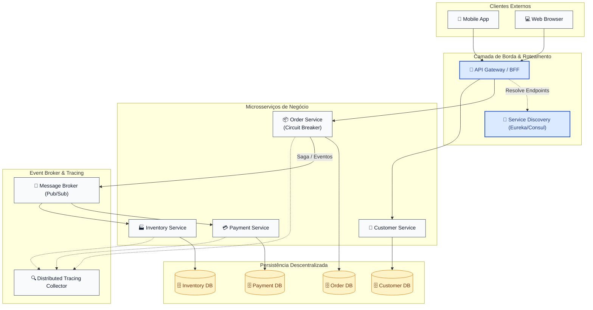

# 10 - Microservices Architecture (Arquitetura de Microsserviços)

---

## 📜 1. O que é e Origem Histórica

A **Arquitetura de Microsserviços (Microservices)** é uma abordagem arquitetural distribuída em que uma aplicação corporativa é estruturada como uma coleção de **serviços pequenos, autônomos, fracamente acoplados e implantáveis de forma independente (*independently deployable*)**.

### Origem e Evolução Histórica
- **2011–2012 (O Termo):** Discutido inicialmente em workshops de arquitetos de software em Veneza (2011) e formalizado por **James Lewis** e **Martin Fowler** no seminal artigo de 2014 (*"Microservices: a definition of this new architectural term"*).
- **A Influência da Netflix e Amazon:** Entre 2008 e 2012, impulsionadas pela transição para a nuvem pública (AWS) e a necessidade de escalabilidade hiperdimensionada, gigantes como Netflix e Amazon pioneirizaram o conceito de times autônomos (*two-pizza teams*) e criaram a suíte pioneira de ferramentas *Netflix OSS* (Eureka, Hystrix, Zuul, Ribbon).
- **A Obra Definitiva de Sam Newman:** Em 2015, Sam Newman publicou *"Building Microservices"*, consolidando as melhores práticas, fronteiras de domínio baseadas em DDD (*Bounded Contexts*) e os padrões essenciais de modelagem e resiliência.

---

## 🏛️ 2. Princípios Fundamentais de Microsserviços

1. **Implantação Independente (*Independent Deployability*):**
   - A capacidade de alterar, testar e subir em produção um único serviço sem a necessidade de coordenar ou recompor qualquer outro serviço do ecossistema.
2. **Modelagem ao Redor de Limites de Negócio (*Bounded Contexts*):**
   - Serviços não são estruturados por camadas técnicas (ex: time de banco de dados, time de UI), mas por capacidades de negócio completas (*Cross-functional teams* seguindo a **Lei de Conway**).
3. **Gerenciamento de Dados Descentralizado (*Database-per-Service*):**
   - Cada microsserviço é o guardião exclusivo de seus dados. Nenhum serviço externo lê ou escreve diretamente no banco de outro serviço; todo acesso ocorre obrigatoriamente através da API pública do serviço proprietário.
4. **Smart Endpoints and Dumb Pipes:**
   - Em contraste direto com o SOA tradicional (onde o barramento ESB concentrava transformações e orquestrações complexas), microsserviços utilizam canais de comunicação simples (*dumb pipes* como HTTP REST, gRPC ou filas de mensageria assíncrona) e lógica de negócio inteligente nas bordas (*smart endpoints*).
5. **Isolamento de Falhas e Tolerância (*Fault Isolation & Resilience*):**
   - Falhas em redes distribuídas são certas e frequentes. O sistema deve operar com degradação graciosa (*graceful degradation*), impedindo falhas em cascata através de *timeouts*, *retries com backoff*, *bulkheads* e *circuit breakers*.

---

## 📊 3. Matriz Comparativa: Monólito vs SOA vs Microsserviços

| Dimensão | Monólito Tradicional | SOA (Service-Oriented) | Microsserviços | Monólito Modular |
|---|---|---|---|---|
| **Granularidade** | Sistema único indivisível | Serviços corporativos amplos | Serviços pequenos e focados | Módulos internos focados |
| **Deploy** | Monolítico (Tudo ou nada) | Monolítico ou por grandes subsistemas | **100% Independente por serviço** | Monolítico único |
| **Banco de Dados** | Banco relacional compartilhado | Frequentemente compartilhado | **Database-per-Service estrito** | Banco único (com schemas separados) |
| **Comunicação** | Chamadas de memória em processo | Barramento Inteligente (**ESB**) | **Smart Endpoints & Dumb Pipes** (REST/gRPC/Kafka) | Chamadas de memória em processo |
| **Governança** | Centralizada e rígida | Centralizada (Comitê de Arquitetura) | **Descentralizada (Poliglota)** | Centralizada na linguagem do monólito |
| **Complexidade Operacional**| Mínima (1 artefato) | Alta (ESB, adaptadores) | **Muito Alta (Orquestração, Observabilidade)** | Baixa a Média |

---

## 🧩 4. Padrões Canônicos da Arquitetura



---

## 🚫 5. Invariantes Arquiteturais (Anti-patterns Críticos)

| Anti-pattern | Sintoma do Desastre | Correção Arquitetural Obrigatória |
|---|---|---|
| **❌ Shared Database (Banco Compartilhado)** | Múltiplos microsserviços acessando a mesma tabela SQL. Altera a coluna e quebra 4 times. | **Database-per-Service:** Cada serviço possui seu próprio banco. Se outro serviço precisa do dado, consulta via API ou consome evento assíncrono. |
| **❌ Distributed Monolith (Monólito Distribuído)** | Deploys precisam ser feitos em cascata ordenada; se o serviço B cai, os serviços A, C e D quebram juntos. | Isolar contratos com versionamento estrito, adotar comunicação assíncrona, tolerância a falhas e desacoplamento temporal. |
| **❌ Entity Services (Serviços Anêmicos)** | Criação de serviços microscópicos que apenas expõem CRUD direto (`/user-service`, `/product-service`) sem regras. | Modelar serviços ao redor de **Capacidades de Negócio** (*Business Capabilities*), e não ao redor de tabelas do banco. |
| **❌ Cascading Synchronous Calls (Chamadas Síncronas em Árvore)** | A chama B que chama C que chama D. A latência é somada e se D falhar, a requisição inteira cai. | Uso de **Saga Pattern**, cache local com replicação eventual de dados e circuit breakers. |

---

## 📂 6. Catálogo dos 6 Exemplos Práticos Implementados

| # | Exemplo | Foco & Padrão de Microsserviço | Cenários Demonstrados |
|---|---|---|---|
| **01** | [`01-ecommerce-api-gateway-bff`](./01-ecommerce-api-gateway-bff/) | **API Gateway & Backend-for-Frontend (BFF)** | Agregação e compressão de payloads sob medida para cliente Mobile vs. Desktop Web, roteamento dinâmico e mascaramento de topologia interna. |
| **02** | [`02-order-saga-orchestrator`](./02-order-saga-orchestrator/) | **Saga Pattern (Orquestrada)** | Transação distribuída de checkout (Pedido $\rightarrow$ Pagamento $\rightarrow$ Estoque) com transações compensatórias automáticas em caso de recusa. |
| **03** | [`03-resilience-circuit-breaker`](./03-resilience-circuit-breaker/) | **Circuit Breaker & Fallback (Hystrix Pattern)** | Estados Fechado, Aberto e Meio-Aberto protegendo chamadas distribuídas com fallback degradado quando serviços downstream falham. |
| **04** | [`04-service-registry-discovery`](./04-service-registry-discovery/) | **Service Discovery & Client-Side Load Balancing** | Registro dinâmico de instâncias efêmeras (estilo Netflix Eureka/Consul), heartbeat health checks e balanceamento Round-Robin no cliente. |
| **05** | [`05-distributed-tracing-correlation`](./05-distributed-tracing-correlation/) | **Distributed Tracing & W3C TraceContext** | Propagação de `Trace-ID` e `Span-ID` através de múltiplos saltos de rede entre serviços, simulando OpenTelemetry sem dependências externas. |
| **06** | [`06-event-driven-choreographed-saga`](./06-event-driven-choreographed-saga/) | **Saga Coreografada via Mensageria Assíncrona** | Orquestração descentralizada de checkout onde serviços reagem a eventos em um barramento leve assíncrono emitindo eventos de compensação. |

---

## 🚀 Como Executar

Cada exemplo possui seu próprio diretório autônomo e executável:
```bash
cd 10-microservices-architecture/01-ecommerce-api-gateway-bff
python3 main.py
```
Zero dependências externas necessárias (utiliza apenas Python 3 standard library).
