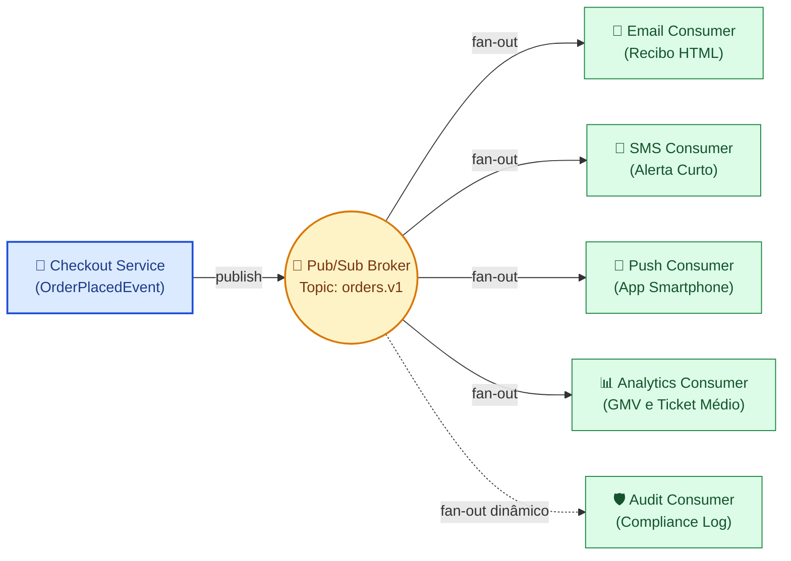

# 01 - Pub/Sub Fan-out Notification (Dispersão de Eventos em Múltiplos Canais)

Este exemplo demonstra a implementação do padrão **Publish/Subscribe com Fan-out** em uma Arquitetura Orientada a Eventos (EDA), onde o encerramento de um pedido de compra (*checkout*) desencadeia ações concorrentes em múltiplos subsistemas consumidores sem nenhum acoplamento com o produtor.

---

## 1. O Desafio Arquitetural

No modelo tradicional síncrono (Request-Reply):
- O serviço de checkout executa o pagamento e é obrigado a chamar diretamente as APIs de E-mail, SMS, Push Notification e Analytics.
- Se o serviço de SMS estiver lento ou fora do ar, o checkout do cliente trava ou falha.
- Toda vez que a equipe de produto decide adicionar um novo canal (ex: notificação via WhatsApp ou envio para Data Lake de Auditoria), o código do `CheckoutService` precisa ser alterado, testado e redeployado (violando o princípio Aberto/Fechado - OCP).

---

## 2. Solução via Pub/Sub Fan-out

1. **Produtor Desacoplado (*CheckoutService*):**
   - Constrói o evento imutável `OrderPlacedEvent` e o publica no tópico `orders.v1` do broker.
   - O produtor não sabe quem consome, quantos são ou quais canais existem.
2. **Topologia Fan-out no Broker (*PubSubBroker*):**
   - Para cada mensagem publicada no tópico, o broker faz o broadcast/fan-out para todos os inscritos registrados de forma autônoma.
3. **Consumidores Autônomos e Independentes:**
   - **`EmailNotificationConsumer`:** Monta o template HTML e despacha o recibo.
   - **`SmsNotificationConsumer`:** Formata a mensagem curta de até 140 caracteres.
   - **`PushNotificationConsumer`:** Gera o banner para smartphone do usuário.
   - **`RealTimeAnalyticsConsumer`:** Atualiza o GMV (*Gross Merchandise Value*) acumulado e o ticket médio em tempo real.
4. **Extensibilidade Dinâmica (*Plug-and-Play*):**
   - Novos consumidores (ex: Auditoria/Compliance) podem se inscrever no tópico a qualquer momento sem necessidade de alterar uma única linha do produtor.

---

## 3. Diagrama de Topologia Fan-out (Mermaid)



---

## 4. Estrutura de Pastas

```
01-pubsub-fanout-notification/
├── broker/
│   ├── __init__.py
│   └── pubsub_broker.py       # Broker com suporte a tópicos e broadcast
├── events/
│   ├── __init__.py
│   └── order_events.py        # Evento de domínio imutável OrderPlacedEvent
├── consumers/
│   ├── __init__.py
│   ├── email_consumer.py      # Consumidor de e-mails
│   ├── sms_consumer.py        # Consumidor de SMS
│   ├── push_consumer.py       # Consumidor de notificações push
│   └── analytics_consumer.py  # Agregador de GMV em tempo real
├── producer/
│   ├── __init__.py
│   └── checkout_producer.py   # Serviço de checkout que emite no broker
├── main.py                    # Cenários de teste executáveis
└── README.md
```

---

## 5. Como Executar

```bash
python3 main.py
```
Zero dependências externas necessárias (utiliza apenas Python 3 standard library).
