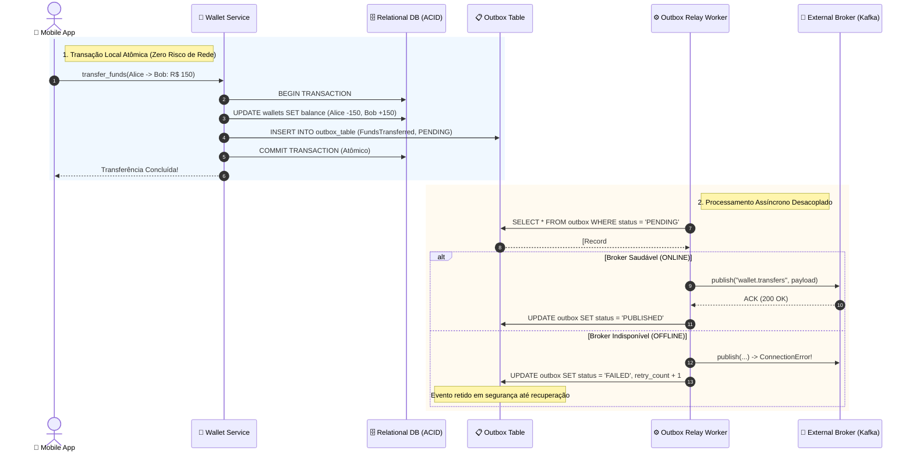

# 02 - Transactional Outbox Pattern (Prevenção do Problema da Escrita Dupla)

Este exemplo demonstra a implementação do padrão **Transactional Outbox**, resolvendo definitivamente o problema da **Escrita Dupla (*Dual-Write Problem*)** em sistemas distribuídos e orientados a eventos.

---

## 1. O Desafio Arquitetural: O Problema da Escrita Dupla

Ao alterar um estado de negócio crítico (ex: transferir saldo entre carteiras bancárias) e notificar outros microsserviços via Apache Kafka ou RabbitMQ, desenvolvedores frequentemente cometem o erro de tentar fazer duas escritas separadas:

### Tentativa Falha A: Grava no Banco e Depois Publica no Broker
```python
db.commit()          # Sucesso: Saldo transferido no PostgreSQL
broker.send(event)   # Falha: Timeout de rede / Kafka cai no instante exato!
```
- **Consequência:** O dinheiro saiu da conta no banco, mas o evento **nunca foi gerado**. Os microsserviços de extrato, notificação e auditoria ficam dessincronizados para sempre.

### Tentativa Falha B: Publica no Broker e Depois Grava no Banco
```python
broker.send(event)   # Sucesso: Evento disparado para o mundo externo
db.commit()          # Falha: Conflito de deadlock / chave primária duplicada!
```
- **Consequência:** Evento fantasma! O sistema notifica que o dinheiro foi transferido, mas a transação no banco sofreu rollback.

---

## 2. Solução via Transactional Outbox Pattern

A garantia de consistência entre banco de dados e mensageria é alcançada usando uma única transação **ACID local**:

1. **Tabela `outbox` no mesmo banco de dados:**
   - Criamos uma tabela `outbox` adjacente às tabelas de negócio no mesmo banco relacional.
2. **Gravação Atômica Única:**
   - O `WalletService` executa o débito/crédito e insere o registro na tabela `outbox` (com `status = 'PENDING'`) dentro de um único bloco de transação (`BEGIN ... COMMIT`).
   - Se o banco falhar, o saldo e o evento sofrem rollback juntos. Se tiver sucesso, ambos são comitados juntos.
3. **Outbox Relay Worker (Processo em Background / CDC):**
   - Um worker independente (simulando Debezium CDC ou Polling Publisher) lê os registros pendentes da tabela outbox.
   - Publica os eventos no broker externo.
   - Ao receber confirmação do broker (*ACK*), marca o registro como `PUBLISHED`.
   - Se o broker estiver fora do ar, os eventos aguardam com segurança dentro da tabela outbox até o broker se recuperar, garantindo **zero perda de dados**.

---

## 3. Diagrama do Ciclo de Vida do Outbox (Mermaid)



---

## 4. Estrutura de Pastas

```
02-transactional-outbox-pattern/
├── storage/
│   ├── __init__.py
│   └── database.py            # Banco de dados com suporte a transações ACID
├── outbox/
│   ├── __init__.py
│   ├── outbox_models.py       # Modelo de dados OutboxRecord e enums
│   └── outbox_relay.py        # Worker assíncrono de repasse para o broker
├── broker/
│   ├── __init__.py
│   └── message_broker.py      # Simulador de Kafka/RabbitMQ com toggle de falha
├── wallet/
│   ├── __init__.py
│   └── wallet_service.py      # Serviço de carteira financeira com gravação no outbox
├── main.py                    # Cenários de teste executáveis
└── README.md
```

---

## 5. Como Executar

```bash
python3 main.py
```
Zero dependências externas necessárias (utiliza apenas Python 3 standard library).
