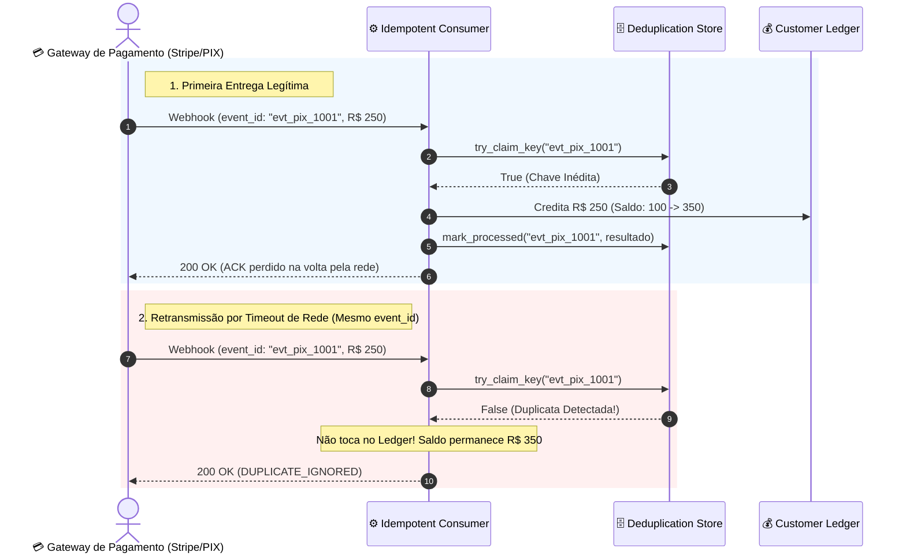

# 03 - Idempotent Consumer & Deduplication Store

Este exemplo demonstra a implementação do padrão **Idempotent Consumer (Consumidor Idempotente)** com um repositório de desduplicação atômica (*Deduplication Store*), garantindo que mensagens retransmitidas em redes distribuídas (*At-Least-Once Delivery*) não causem duplicidade de efeitos colaterais.

---

## 1. O Desafio Arquitetural: A Ilusão do Exactly-Once

Brokers distribuídos (Apache Kafka, RabbitMQ, AWS SQS) e gateways de pagamento externos (Stripe, Mercado Pago, PIX) operam sob a garantia de **entrega pelo menos uma vez (*At-Least-Once Delivery*)**:
- Se um consumidor processa uma mensagem com sucesso mas o pacote de confirmação TCP/ACK sofre perda de pacotes na volta, o gateway retransmitirá a mesma mensagem após o timeout.
- Se o consumidor não for idempotente:
  - Um pagamento de R$ 250,00 recebido duas vezes creditará R$ 500,00 na conta do cliente (gerando prejuízo financeiro irreversível).

---

## 2. Solução via Idempotent Consumer Pattern

Para alcançar semântica de **efetivamente uma vez (*Effectively-Once*)**:

1. **Chave de Idempotência Natural ou Sintética:**
   - Cada evento carrega um identificador imutável exclusivo (`event_id` ou `Idempotency-Key`).
2. **Deduplication Store Atômico (Redis / Tabela SQL com Constraint Única):**
   - Antes de executar qualquer lógica de negócio, o consumidor invoca `try_claim_key(idempotency_key)`.
   - Se a chave já existir no banco de deduplicação, o consumidor detecta a duplicata imediatamente:
     - Não altera saldos nem executa transações de negócio.
     - Retorna o resultado anterior em cache ou ignora a mensagem com segurança (`DUPLICATE_IGNORED`).
3. **Persistência do Resultado:**
   - Na primeira entrega legítima, a lógica contábil é executada e o resultado é gravado junto da chave no store para responder a futuras duplicatas com consistência.

---

## 3. Diagrama de Sequência de Desduplicação (Mermaid)



---

## 4. Estrutura de Pastas

```
03-idempotent-consumer-deduplication/
├── store/
│   ├── __init__.py
│   └── deduplication_store.py  # Repositório de chaves e controle de duplicatas
├── events/
│   ├── __init__.py
│   └── payment_events.py       # Modelo de dados PaymentWebhookEvent
├── consumer/
│   ├── __init__.py
│   └── idempotent_payment_consumer.py # Consumidor protegido contra retransmissões
├── main.py                     # Cenários de teste e simulação de rajada
└── README.md
```

---

## 5. Como Executar

```bash
python3 main.py
```
Zero dependências externas necessárias (utiliza apenas Python 3 standard library).
