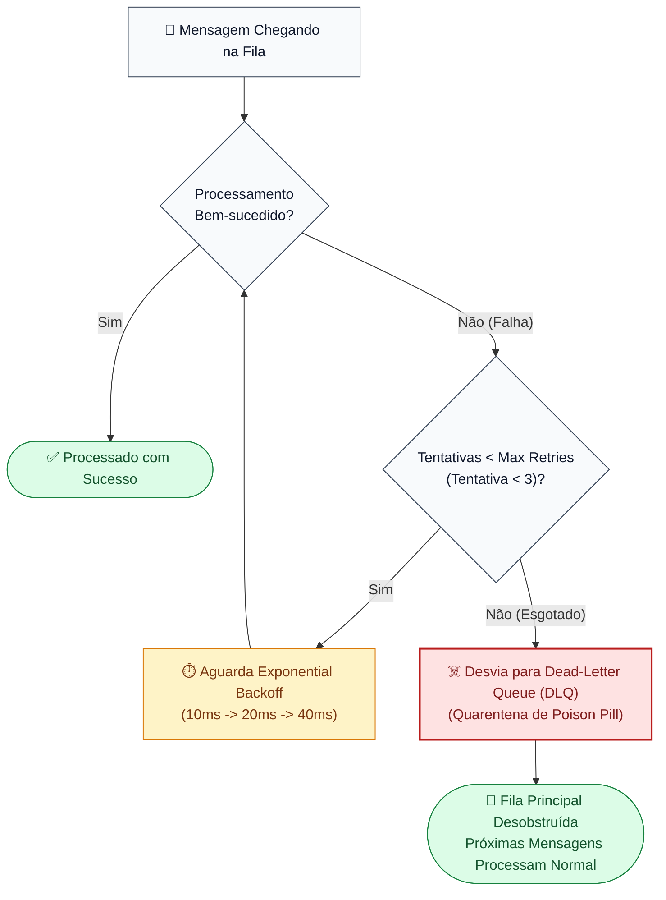

# 04 - Dead-Letter Queue (DLQ) & Exponential Backoff

Este exemplo demonstra a implementação de políticas de resiliência em consumidores orientados a eventos, combinando **Exponential Backoff** para falhas transitórias e **Dead-Letter Queue (DLQ)** para isolamento de mensagens venenosas (*Poison Pills*).

---

## 1. O Desafio Arquitetural: Mensagens Venenosas e Head-of-Line Blocking

Em arquiteturas orientadas a eventos (Kafka, SQS, RabbitMQ), mensagens passam por consumidores que realizam validações, processamentos em lote ou chamadas de rede externas:
- **Falhas Transitórias:** Uma oscilação temporária na rede ou um timeout de 200ms pode ser resolvido com retentativas calculadas (*Retries com Backoff*).
- **Mensagens Venenosas (*Poison Pills*):** Uma mensagem com payload corrompido, tipo inválido ou violação de esquema de banco que lança uma exceção irrecuperável.
- **O Desastre do Bloqueio de Fila (*Head-of-Line Blocking*):** Sem uma DLQ, o consumidor tenta reprocessar a mensagem venenosa indefinidamente em loop infinito. A mensagem emperra no topo da fila/partição, impedindo que milhares de mensagens sadias subsequentes sejam processadas.

---

## 2. Solução via Exponential Backoff e DLQ

1. **Política de Retentativas com Backoff Exponencial (`RetryPolicy`):**
   - Configura número máximo de tentativas (`max_retries = 3`).
   - Calcula tempo de espera exponencial entre tentativas para não sobrecarregar serviços downstream:
     $$\text{delay} = \min(\text{initial\_delay} \times \text{multiplier}^{\text{attempt}}, \text{max\_delay})$$
2. **Desvio para a Dead-Letter Queue (`DeadLetterQueue`):**
   - Quando o limite de retentativas é esgotado, a mensagem é imediatamente desviada para a fila de mensagens mortas (*DLQ*) com metadados do erro (`error_reason`, `retry_count`, `original_topic`).
   - A fila principal é desobstruída instantaneamente, permitindo que o consumidor continue processando o tráfego regular normalmente.
3. **Auditoria e Replay:**
   - Engenheiros e operadores podem inspecionar mensagens na DLQ, corrigir eventuais bugs de esquema e reprocessá-las com segurança (*Dead-Letter Replay*).

---

## 3. Diagrama de Fluxo e Quarentena (Mermaid)



---

## 4. Estrutura de Pastas

```
04-dead-letter-queue-retry-backoff/
├── dlq/
│   ├── __init__.py
│   ├── retry_policy.py        # Cálculo de retentativas com recuo exponencial
│   └── dead_letter_queue.py   # Repositório de quarentena de mensagens mortas
├── consumer/
│   ├── __init__.py
│   └── resilient_event_consumer.py # Consumidor com laço de retry e desvio
├── main.py                    # Cenários de teste executáveis
└── README.md
```

---

## 5. Como Executar

```bash
python3 main.py
```
Zero dependências externas necessárias (utiliza apenas Python 3 standard library).
