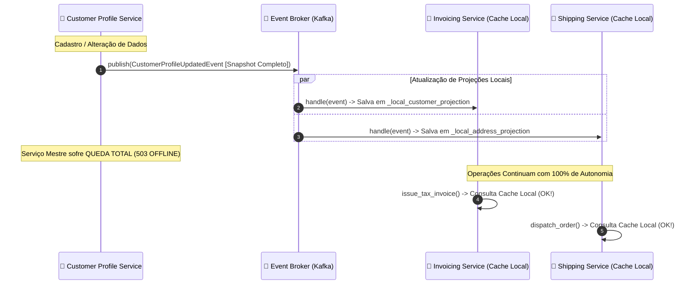

# 05 - Event-Carried State Transfer (ECST) e Autonomia de Consumidores

Este exemplo demonstra a implementação do padrão **Event-Carried State Transfer (ECST)**, permitindo que microsserviços e subsistemas mantenham projeções de leitura locais perfeitamente autônomas, eliminando acoplamento temporal e chamadas síncronas REST a serviços mestres.

---

## 1. O Desafio Arquitetural: Event Notification vs. ECST

Martin Fowler formalizou a diferença crucial entre dois estilos de eventos:

### Estilo A: Event Notification (Notificação Minimalista)
O evento envia apenas o identificador:
```json
{"event": "CustomerUpdated", "customer_id": "CUST-100"}
```
- **O Problema:** Os consumidores (`InvoicingService`, `ShippingService`) precisam dos dados fiscais e do endereço. Eles são obrigados a fazer chamadas síncronas HTTP REST de volta para o `CustomerProfileService`.
- **Consequência:** A arquitetura volta a ter dependência temporal síncrona em rede ($N$ chamadas remotas adicionais). Se o `CustomerProfileService` estiver fora do ar ou sob alta carga, o faturamento e a expedição inteiros travam.

---

## 2. Solução via Event-Carried State Transfer (ECST)

No padrão **ECST**, o evento carrega o **snapshot completo e denormalizado** do estado atual da entidade:

```json
{
  "event_id": "EVT-CUST-8F12",
  "sequence_number": 2,
  "customer": {
    "customer_id": "CUST-100",
    "full_name": "TechSolutions Ltda",
    "tax_id": "12.345.678/0001-90",
    "billing_address": {
      "city": "São Paulo",
      "postal_code": "01310-100"
    }
  }
}
```

### Vantagens Arquiteturais:
1. **Zero Saltos de Rede em Leitura:** Cada microsserviço armazena uma **projeção local** com os campos de que necessita.
2. **Autonomia Radical & Alta Disponibilidade:** Mesmo que o serviço mestre de clientes sofra um colapso total (queda de banco ou 503 HTTP), os sistemas de faturamento e expedição continuam funcionando normalmente sem qualquer degradação.
3. **Escalabilidade Extrema:** Elimina gargalos de leitura no serviço central.

---

## 3. Diagrama de Sequência e Autonomia (Mermaid)



---

## 4. Estrutura de Pastas

```
05-event-carried-state-transfer/
├── events/
│   ├── __init__.py
│   └── customer_events.py     # Modelo do snapshot e evento ECST
├── broker/
│   ├── __init__.py
│   └── event_broker.py        # Barramento de mensageria leve
├── producer/
│   ├── __init__.py
│   └── customer_profile_service.py # Serviço mestre (Master Data)
├── consumers/
│   ├── __init__.py
│   ├── invoicing_service.py   # Consumidor de faturamento com projeção local
│   └── shipping_service.py    # Consumidor de frete com projeção local
├── main.py                    # Cenários de teste e simulação de queda do mestre
└── README.md
```

---

## 5. Como Executar

```bash
python3 main.py
```
Zero dependências externas necessárias (utiliza apenas Python 3 standard library).
