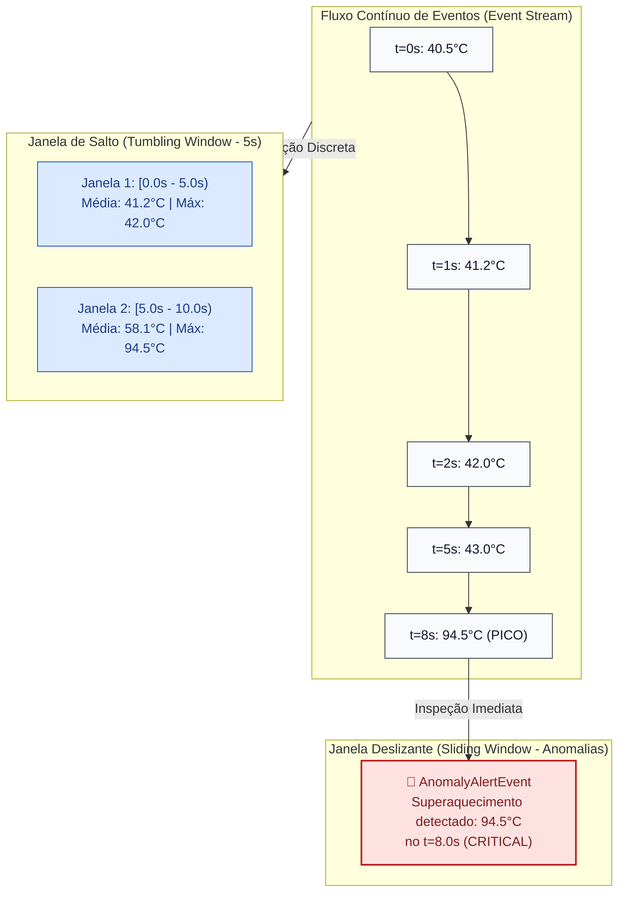

# 06 - Stream Processing & Time Windowing (Janelas Temporais e Detecção de Anomalias)

Este exemplo demonstra a implementação dos conceitos fundamentais de **Stream Processing (Processamento de Fluxos Contínuos)** em Event-Driven Architecture (padrão consagrado em *Apache Flink*, *Kafka Streams* e *Spark Streaming*), utilizando **Janelas de Salto (*Tumbling Windows*)** e **Janelas Deslizantes (*Sliding Windows*)** para telemetria IoT e detecção de anomalias em tempo real.

---

## 1. O Desafio Arquitetural

Em sistemas modernos de Internet das Coisas (IoT), telemetria veicular, mercado financeiro e monitoramento de infraestrutura, os dados não chegam como tabelas estáticas, mas como um **fluxo infinito e ininterrupto de eventos ao longo do tempo**:
- Como calcular a temperatura média de uma turbina sem armazenar gigabytes de histórico bruto?
- Como detectar um pico súbito de calor ou uma fraude financeira em menos de 100ms antes que cause danos físicos?

---

## 2. Solução via Operadores de Janelas Temporais

O processamento de streams resolve isso particionando o fluxo temporal contínuo em **janelas discretas**:

### 1. Janela de Salto / Fixa (*Tumbling Window*)
- Intervalos de tempo de tamanho fixo, contíguos e **não sobrepostos** (ex: $[0s - 5s)$, $[5s - 10s)$, $[10s - 15s)$).
- Cada evento pertence a exatamente uma única janela.
- Quando o relógio avança além do limite final da janela, ela fecha automaticamente e emite um evento sumarizado com agregações consolidadas (mínimo, máximo, contagem, média).

### 2. Janela Deslizante (*Sliding Window*)
- Mantém um buffer contínuo dos eventos que ocorreram nos últimos $N$ segundos em relação ao instante atual.
- Conforme novos eventos chegam, os eventos que ultrapassaram a cauda da janela são expulsos (*eviction*).
- Ideal para **Detecção de Anomalias e Picos**: se qualquer leitura dentro da janela ultrapassar o limiar crítico ($85^\circ\text{C}$), um evento de alerta de severidade crítica é disparado imediatamente em tempo real.

---

## 3. Diagrama Comparativo de Janelas Temporais (Mermaid)



---

## 4. Estrutura de Pastas

```
06-stream-processing-windowing/
├── stream/
│   ├── __init__.py
│   ├── telemetry_events.py    # Eventos de leitura, sumário de janela e alerta
│   ├── tumbling_window.py     # Agregador de janelas fixas não sobrepostas
│   └── sliding_window.py      # Detector de anomalias com janela contínua móvel
├── pipeline/
│   ├── __init__.py
│   └── stream_processor.py    # Coordenador do pipeline de streaming
├── main.py                    # Cenários de teste executáveis
└── README.md
```

---

## 5. Como Executar

```bash
python3 main.py
```
Zero dependências externas necessárias (utiliza apenas Python 3 standard library).
