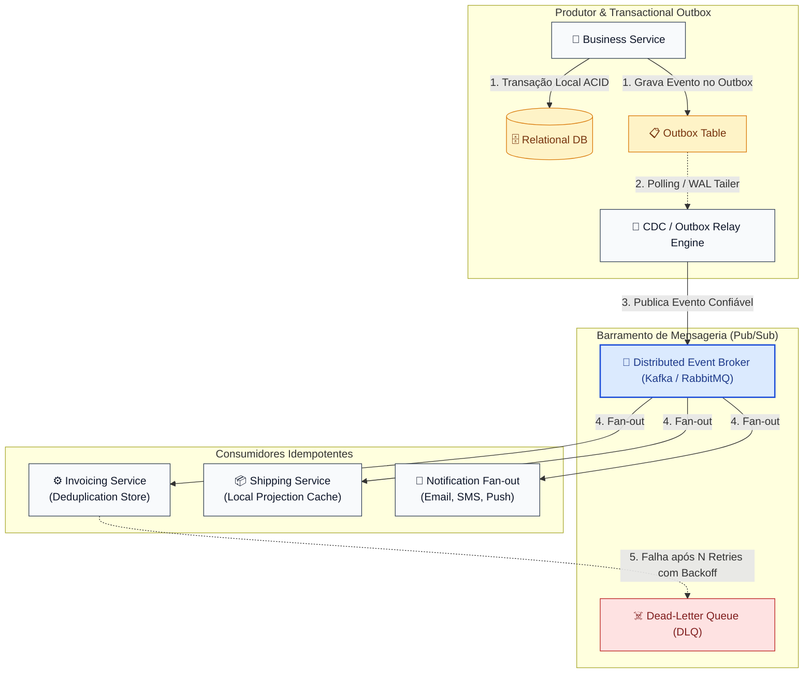

# 11 - Event-Driven Architecture (Arquitetura Orientada a Eventos - EDA)

---

## 📜 1. O que é e Origem Histórica

A **Arquitetura Orientada a Eventos (EDA - Event-Driven Architecture)** é um paradigma arquitetural distribuído no qual a captura, comunicação, processamento e persistência de **eventos imutáveis** constituem o mecanismo primário de coordenação e integração do sistema.

### O que é um Evento de Domínio?
Um evento é um registro imutável no tempo que declara: **"algo significativo já aconteceu no negócio"** (expressado no tempo passado, ex: `OrderPlaced`, `PaymentSettled`, `TemperatureThresholdExceeded`). 
Ao contrário de comandos imperativos (*Commands*, ex: `CancelOrder`), eventos não impõem ordens nem assumem como os consumidores devem reagir.

### Origem e Evolução Histórica
- **Anos 1980–1990 (Sistemas Reativos e GUI):** Event-driven programming surgiu fortemente em interfaces gráficas (loops de eventos do Windows e X11: cliques de mouse e teclas) e em sistemas operacionais orientados a interrupções (*hardware interrupts*).
- **Final dos anos 1990 (Message-Oriented Middleware - MOM):** JMS (Java Message Service), IBM MQ e TIBCO Rendezvous popularizaram filas corporativas (*queues*) e tópicos (*topics*).
- **2006 (Complex Event Processing - CEP):** David Luckham publicou *"The Power of Events"*, formalizando a análise temporal de fluxos de eventos em tempo real para detecção de fraudes financeiras e telemetria.
- **2010+ (A Revolução do Log Distribuído - Apache Kafka):** Desenvolvido no LinkedIn por Jay Kreps, Neha Narkhede e Jun Rao, o Kafka redefiniu o paradigma de mensageria: substituiu filas efêmeras e destrutivas por um **Commit Log imutável e particionado**, permitindo replay de eventos, retenção durável e escalabilidade massiva. Martin Fowler consolidou os 4 tipos de arquiteturas de eventos (*Event Notification, Event-Carried State Transfer, Event Sourcing, e CQRS*).

---

## 🏛️ 2. Princípios Fundamentais de EDA

1. **Desacoplamento Espacial e Temporal:**
   - **Espacial:** O produtor não conhece as identidades, endereços de rede, tecnologias ou quantidade de consumidores que escutam seus eventos.
   - **Temporal:** O produtor e os consumidores não precisam estar online simultaneamente. Se o consumidor estiver em manutenção ou fora do ar, as mensagens aguardam com segurança no broker.
2. **Imutabilidade e Semântica de Fato Histórico:**
   - Um evento é um fato consumado que não pode ser desfeito, alterado ou apagado. Se houver erro, um novo evento de correção é emitido (ex: `TransactionReversed`).
3. **Semânticas de Entrega (*Delivery Semantics*):**
   - **At-least-once (Pelo menos uma vez):** Padrão predominante em brokers distribuídos. Garante que nenhuma mensagem seja perdida, mas duplicatas podem ocorrer durante falhas de rede.
   - **At-most-once (No máximo uma vez):** Sem retransmissão; prioriza baixa latência em detrimento de perdas.
   - **Idempotência no Consumidor (Efetivamente uma vez):** Como brokers garantem *at-least-once*, todo consumidor maduro DEVE ser estritamente idempotente (armazenando chaves de desduplicação).
4. **O Problema da Escrita Dupla e o Transactional Outbox Pattern:**
   - Em sistemas distribuídos, tentar salvar no banco relacional e logo em seguida publicar no Kafka gera inconsistência inevitável caso o broker ou o banco caiam no meio do caminho. O **Outbox Pattern** resolve isso salvando a entidade e o evento na mesma transação ACID do banco local.
5. **Event-Carried State Transfer (ECST):**
   - Em vez de emitir apenas IDs (forçando consumidores a fazer chamadas síncronas REST de volta para buscar os dados), o evento carrega um snapshot denormalizado do estado, permitindo que consumidores mantenham projeções locais autônomas.

---

## 📊 3. Matriz Comparativa: Request-Reply vs. EDA vs. Batch Processing

| Dimensão | Request-Reply (REST / gRPC) | Event-Driven Architecture (EDA) | Batch Processing (Lote) |
|---|---|---|---|
| **Acoplamento** | Alto (Temporal e Espacial) | **Mínimo (Desacoplamento Total)** | Médio (Agendamento rígido) |
| **Comunicação** | Síncrona bloqueante | **Assíncrona orientada a eventos** | Assíncrona diferida |
| **Consistência** | Consistência Imediata (ACID) | **Consistência Eventual (BASE)** | Consistência Periódica |
| **Throughput** | Limitado pela latência da cadeia | **Extremo (Buffers no Broker)** | Muito Alto (Job programado) |
| **Tolerância a Falhas**| Se o destino cair, requisição falha | **Tolerante (Armazenado no Broker)** | Tolerante a reexecução do job |
| **Rastreabilidade** | Simples (Call Stack) | **Complexa (Distributed Tracing)** | Simples (Logs de execução) |

---

## 🧩 4. Padrões Canônicos da Arquitetura



---

## 🚫 5. Invariantes Arquiteturais (Anti-patterns Críticos)

| Anti-pattern | Sintoma do Desastre | Correção Arquitetural Obrigatória |
|---|---|---|
| **❌ RPC-over-Messaging (Eventos como Comandos)** | Usar eventos esperando resposta síncrona imediata com correlação bidirecional em cadeia. | Se você precisa de resposta síncrona imediata, use gRPC ou REST. Em EDA, eventos informam o passado (*fire-and-forget*). |
| **❌ Falta de Idempotência no Consumidor** | Processar o mesmo evento duas vezes (ex: debitar a conta ou enviar o produto duas vezes devido a retry de rede). | Armazenar o `event_id` processado em uma tabela de desduplicação atômica (*Idempotent Consumer Pattern*). |
| **❌ Escrita Dupla sem Outbox (Dual-Write Anti-pattern)** | Salvar no PostgreSQL e chamar `broker.send()`. Se o broker falhar, o banco fica dessincronizado do mundo externo. | **Transactional Outbox Pattern:** Salvar evento na tabela Outbox na mesma transação do banco e usar um processo coletor confiável. |
| **❌ Retries Infinitos Bloqueantes (Poison Pill)** | Mensagem malformada que lança exceção trava a fila inteira para sempre tentando reprocessar sem parar. | **Dead-Letter Queue (DLQ):** Após N tentativas com Exponential Backoff, desviar a mensagem venenosa para uma DLQ e prosseguir com a fila. |

---

## 📂 6. Catálogo dos 6 Exemplos Práticos Implementados

| # | Exemplo | Foco & Padrão de EDA | Cenários Demonstrados |
|---|---|---|---|
| **01** | [`01-pubsub-fanout-notification`](./01-pubsub-fanout-notification/) | **Pub/Sub Fan-out com Particionamento** | Dispersão de evento `OrderPlaced` para múltiplos canais concorrentes (Email, SMS, Push e Analytics) sem acoplamento. |
| **02** | [`02-transactional-outbox-pattern`](./02-transactional-outbox-pattern/) | **Transactional Outbox & Dual-Write Prevention** | Eliminação do problema de escrita dupla em carteira digital: commit ACID local e polling relay resiliente para o broker. |
| **03** | [`03-idempotent-consumer-deduplication`](./03-idempotent-consumer-deduplication/) | **Idempotent Consumer & Deduplicação Atômica** | Processamento de Webhooks de pagamento com retransmissões de rede e chave de idempotência garantindo efeito único. |
| **04** | [`04-dead-letter-queue-retry-backoff`](./04-dead-letter-queue-retry-backoff/) | **Dead-Letter Queue (DLQ) & Exponential Backoff** | Tratamento de mensagens venenosas (*Poison Pills*) com retentativas calculadas exponencialmente e desvio para DLQ. |
| **05** | [`05-event-carried-state-transfer`](./05-event-carried-state-transfer/) | **Event-Carried State Transfer (ECST)** | Replicação de snapshot completo de cliente em eventos, eliminando consultas síncronas REST nos serviços de faturamento e logística. |
| **06** | [`06-stream-processing-windowing`](./06-stream-processing-windowing/) | **Stream Processing com Janelas Temporais** | Análise de telemetria IoT em tempo real com janelas de salto (*Tumbling*) e deslizantes (*Sliding*) para detecção de anomalias. |

---

## 🚀 Como Executar

Cada exemplo possui seu próprio diretório autônomo e executável:
```bash
cd 11-event-driven-architecture/01-pubsub-fanout-notification
python3 main.py
```
Zero dependências externas necessárias (utiliza apenas Python 3 standard library).
