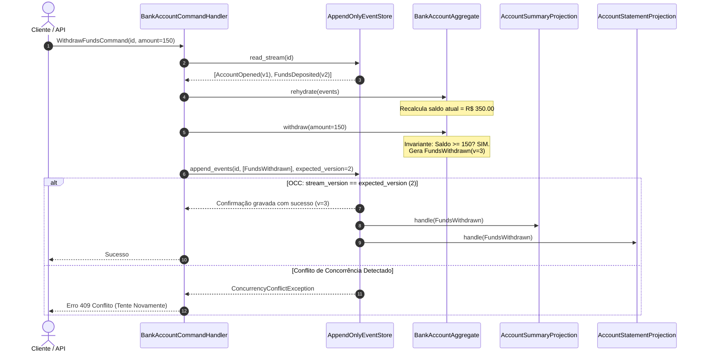

# Exemplo 01: Livro-Razão Bancário com Event Sourcing e OCC

Este exemplo implementa um subsistema bancário transacional completo utilizando o padrão **CQRS (Command Query Responsibility Segregation)** e **Event Sourcing**, apoiado por **Controle de Concorrência Otimista (OCC - Optimistic Concurrency Control)**.

---

## 1. Problema e Motivação

No modelo bancário tradicional CRUD, o saldo de uma conta é mantido em uma coluna `balance DECIMAL(15,2)` na tabela `accounts`. Quando um saque de R$ 100 ocorre, o banco executa:
```sql
UPDATE accounts SET balance = balance - 100 WHERE id = 'ACC-001';
```
Esse desenho apresenta deficiências estruturais:
1. **Perda de Histórico:** A linha sobrescreve o valor anterior. Não há registro intrínseco de quando ou por que o saldo mudou.
2. **Concorrência e Contenção de Locks:** Transações concorrentes bloqueiam a linha da tabela, gerando gargalos e *deadlocks*.
3. **Auditoria Externa:** Para saber a origem de uma discrepância contábil, é necessário recorrer a logs de aplicação ou tabelas satélites assíncronas que podem falhar ou dessincronizar.

Com **Event Sourcing**, o estado nunca é mutado ou deletado. A conta bancária é um **Stream de Eventos Imutáveis** (`AccountOpened`, `FundsDeposited`, `FundsWithdrawn`, `FundsTransferredOut`, etc.). O saldo em qualquer momento é a soma algébrica de todos os eventos registrados no stream.

---

## 2. Diagrama de Arquitetura e Fluxo



---

## 3. Estrutura de Arquivos

```
01-bank-account-event-sourced/
├── domain/
│   ├── aggregate.py        # Agregado com re-hidratação e validação de invariantes
│   ├── commands.py         # DTOs de comando (Open, Deposit, Withdraw, Transfer, Close)
│   ├── events.py           # Eventos imutáveis com timestamp, version e event_id
│   └── exceptions.py       # Exceções de negócio e ConcurrencyConflictException
├── infrastructure/
│   └── event_store.py      # Event Store append-only com OCC e publish síncrono
├── application/
│   └── command_handlers.py # Orquestrador do Write Side
├── projections/
│   ├── account_summary.py   # Read Model: Visão sumarizada (saldo, titular, status)
│   └── account_statement.py # Read Model: Extrato transacional cronológico
├── main.py                 # Demonstração executável de cenários
└── README.md               # Esta documentação
```

---

## 4. Invariantes de Negócio Implementadas

1. **Conta Ativa:** Nenhuma operação financeira pode ser executada em uma conta inexistente ou encerrada (`AccountInactiveException`).
2. **Saldo Não Negativo:** Saques e transferências que excedam o saldo disponível são sumariamente rejeitados pelo agregado (`InsufficientFundsException`), sem poluir o Event Store.
3. **Valores Positivos:** Depósitos, saques e transferências com valor $\le 0$ são bloqueados (`InvalidAmountException`).
4. **Controle de Concorrência Otimista (OCC):** Duas operações simultâneas que leram a mesma versão $V$ não podem comitar; a primeira incrementa o stream para $V+1$ e a segunda falha com `ConcurrencyConflictException`.
5. **Encerramento Condicional:** A conta só pode ser encerrada se o saldo for exatamente zero (`DomainException`).

---

## 5. Como Executar

```bash
python3 01-bank-account-event-sourced/main.py
```
