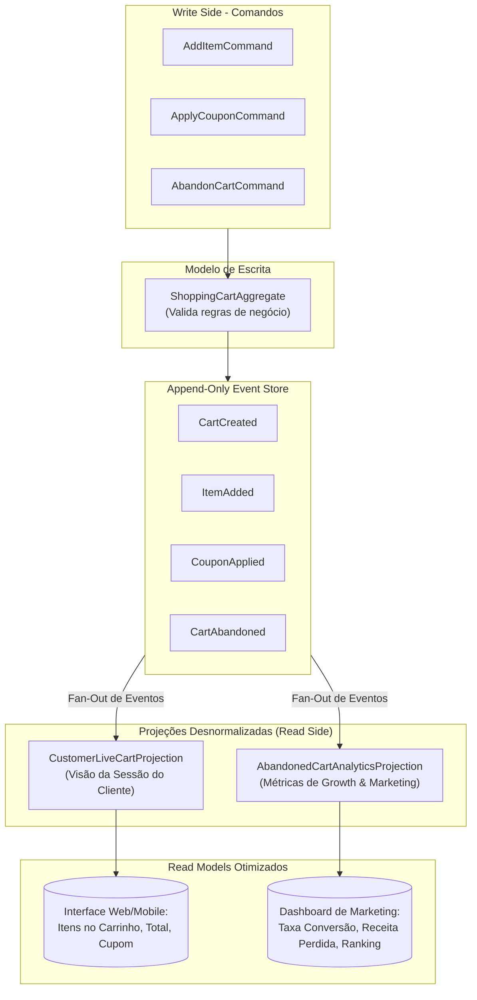

# Exemplo 02: Carrinho de Compras E-Commerce com Múltiplas Projeções

Este exemplo demonstra um dos maiores poderes da arquitetura **CQRS & Event Sourcing**: a capacidade de alimentar múltiplos modelos de leitura (*Read Models / Projections*) radicalmente diferentes a partir do **mesmo fluxo unificado de eventos de domínio**.

---

## 1. Problema e Motivação

No modelo tradicional CRUD:
- O carrinho de compras vive em tabelas como `carts` e `cart_items`.
- Quando um cliente remove um item ou abandona o carrinho (fecha a aba do navegador), os itens são deletados (`DELETE FROM cart_items`) ou o carrinho simplesmente fica esquecido no banco de dados.
- Para gerar relatórios de **taxa de abandono**, **itens mais abandonados** e **perda estimada de receita**, as equipes de marketing e BI precisam de *jobs* pesados de ETL ou tabelas de rastreamento com acoplamento prejudicial.

Com **CQRS e Event Sourcing**:
- Cada ação é um evento imutável (`CartCreated`, `ItemAdded`, `ItemRemoved`, `ItemQuantityUpdated`, `CouponApplied`, `CartCheckedOut`, `CartAbandoned`).
- O **mesmo fluxo de eventos** alimenta simultaneamente:
  1. **`CustomerLiveCartProjection`:** Otimizada para o cliente final navegar na loja, ver subtotal, desconto e itens no carrinho.
  2. **`AbandonedCartAnalyticsProjection`:** Otimizada para o painel de Marketing/Growth, calculando taxa de conversão, receita perdida em abandonos e ranking dos produtos mais abandonados.

---

## 2. Diagrama de Fluxo e Multi-Projeções



---

## 3. Estrutura de Arquivos

```
02-ecommerce-shopping-cart-projections/
├── domain/
│   ├── aggregate.py                    # Regras de negócio do carrinho de compras
│   ├── commands.py                     # DTOs de comandos
│   ├── events.py                       # Eventos de domínio imutáveis
│   └── exceptions.py                   # Exceções de domínio
├── infrastructure/
│   └── event_store.py                  # Event Store em memória com pub/sub
├── application/
│   └── command_handlers.py             # Handler de comandos
├── projections/
│   ├── customer_live_cart.py           # Read Model da tela do cliente
│   └── abandoned_cart_analytics.py     # Read Model de BI / Growth / Marketing
├── main.py                             # Script de teste e demonstração
└── README.md                           # Documentação deste exemplo
```

---

## 4. Como Executar

```bash
python3 02-ecommerce-shopping-cart-projections/main.py
```
