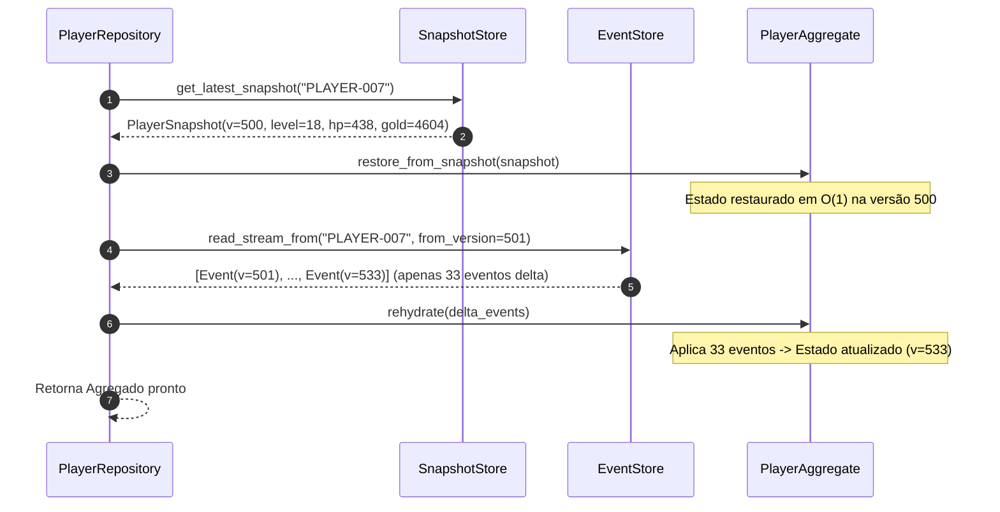

# Exemplo 03: Aggregate Snapshotting e Otimização de Performance

Este exemplo demonstra a técnica fundamental de **Snapshotting de Agregados** para mitigar o problema de degradação linear $O(N)$ na re-hidratação de streams de eventos de alta frequência no padrão **Event Sourcing**.

---

## 1. O Problema da Degradação Linear $O(N)$

Em sistemas orientados a Event Sourcing puro, a reconstrução do estado atual de um Agregado exige a leitura e a aplicação sequencial de **todos os eventos** desde o nascimento da entidade:
$$\text{Estado}(N) = \sum_{i=1}^{N} \text{apply}(\text{Evento}_i)$$

À medida que o sistema opera ao longo de meses ou anos, certos fluxos acumulam dezenas ou centenas de milhares de eventos (ex: telemetria IoT, sessões de jogos online, livros de ordens financeiras). Carregar 50.000 eventos a cada comando de escrita introduz:
1. **Latência Inaceitável:** O tempo de deserialização e execução de `apply(event)` cresce linearmente com $N$.
2. **Pressão de Memória e Rede:** Transferir milhares de objetos imutáveis do Event Store para a aplicação satura o garbage collector e a banda de rede.

---

## 2. A Solução: Snapshotting + Delta Replay

Um **Snapshot** é um instantâneo serializado do estado interno do agregado gravado periodicamente a cada $K$ eventos (ex: $K=50$ ou $K=100$).

Ao carregar o agregado:
1. O repositório busca o **Snapshot mais recente** no `SnapshotStore` (complexidade $O(1)$).
2. Se o snapshot estiver na versão $S$, o repositório lê no `EventStore` apenas os eventos delta onde $\text{version} > S$.
3. O agregado restaura o snapshot em $O(1)$ e re-hidrata apenas os $N - S$ eventos restantes ($N \pmod K$).



---

## 3. Estrutura de Arquivos

```
03-aggregate-snapshotting-performance/
├── domain/
│   ├── aggregate.py            # PlayerAggregate com suporte a snapshots e re-hidratação
│   ├── events.py               # Eventos de domínio (Spawned, Damage, Heal, XP, Level, Gold)
│   └── snapshot.py             # DTO imutável PlayerSnapshot
├── infrastructure/
│   ├── event_store.py          # Event Store com suporte a Delta Read (read_stream_from)
│   ├── snapshot_store.py       # Repositório de snapshots em memória
│   └── repository.py           # Repositório dual (Full Replay vs. Snapshot + Delta)
├── main.py                     # Benchmark comparativo com 500+ eventos
└── README.md                   # Esta documentação
```

---

## 4. Resultados do Benchmark

Em execução com **549 eventos** em Python 3:
- **Estratégia A (Full Replay - $O(N)$):**
  - Eventos processados: **549 eventos**
  - Latência média: **~2.2 ms**
- **Estratégia B (Snapshot + Delta - $O(N \pmod K)$):**
  - Eventos processados: **33 eventos delta** (redução de **94%** no volume de eventos)
  - Latência média: **~0.12 ms** (aceleração de **~18x**)
- **Equivalência de Estado:** 100% idêntico em todas as variáveis (HP, Nível, XP, Ouro, Versão).

---

## 5. Como Executar

```bash
python3 03-aggregate-snapshotting-performance/main.py
```
