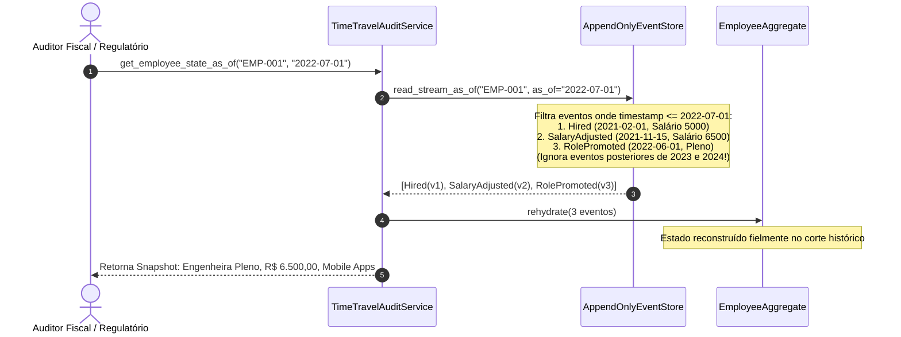

# Exemplo 04: Motor de Auditoria Temporal e Viagem no Tempo (Time Travel)

Este exemplo demonstra como a arquitetura de **Event Sourcing** viabiliza consultas temporais (*As-Of Temporal Queries*), permitindo inspecionar com exatidão matemática o estado de qualquer entidade em qualquer instante do passado.

---

## 1. Problema e Motivação

Em sistemas corporativos convencionais de RH e Folha de Pagamento baseados em CRUD:
- Quando um funcionário é promovido de cargo e recebe um reajuste salarial, o sistema executa:
  ```sql
  UPDATE employees SET role = 'Tech Lead', salary = 17500.00 WHERE id = 'EMP-001';
  ```
- Se dois anos depois a Receita Federal ou um auditor trabalhista solicitar:
  > *"Qual era o salário base exato e o departamento deste colaborador em 1º de julho de 2022?"*
- O sistema CRUD tradicional **não consegue responder** sem recorrer a fitas de backup antigas, restauração de bancos de dados legados ou cruzamento impreciso de logs de texto.

---

## 2. A Solução com Event Sourcing

No Event Sourcing, cada mutação de carreira é um evento com carimbo de data/hora imutável (`timestamp`):
- `EmployeeHired`
- `DepartmentTransferred`
- `SalaryAdjusted`
- `RolePromoted`
- `BonusAwarded`

Para saber o estado em qualquer data $T_{\text{corte}}$, o **Time-Travel Engine** simplesmente filtra o stream de eventos:
$$\text{EventosRelevantes} = \{ e \in \text{Stream} \mid e.\text{timestamp} \le T_{\text{corte}} \}$$
E executa a re-hidratação:
$$\text{Estado}(T_{\text{corte}}) = \text{rehydrate}(\text{EventosRelevantes})$$



---

## 3. Estrutura de Arquivos

```
04-temporal-time-travel-audit/
├── domain/
│   ├── aggregate.py            # EmployeeAggregate com re-hidratação histórica
│   └── events.py               # Eventos imutáveis com timestamps cronológicos
├── infrastructure/
│   └── event_store.py          # AppendOnlyEventStore com read_stream_as_of()
├── services/
│   └── time_travel_engine.py   # Serviço de auditoria temporal e snapshots históricos
├── main.py                     # Demonstração executável de consultas no tempo
└── README.md                   # Esta documentação
```

---

## 4. Como Executar

```bash
python3 04-temporal-time-travel-audit/main.py
```
