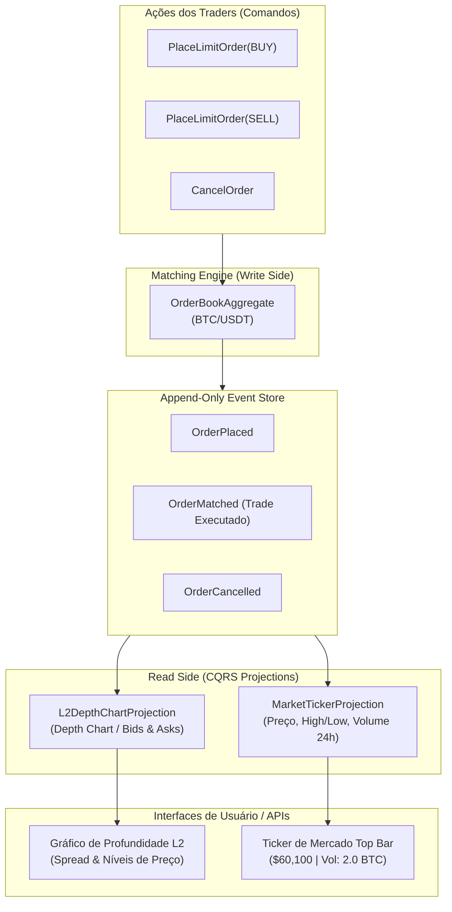

# Exemplo 05: Livro de Ofertas Cripto (L2 Order Book) com CQRS & Event Sourcing

Este exemplo modela o núcleo de uma corretora de criptoativos (*Crypto Exchange*), separando com rigor o **Motor de Casamento de Ordens (*Matching Engine* - Write Model)** das **Projeções de Mercado em Tempo Real (*Read Models*)**.

---

## 1. Problema e Motivação

Sistemas de negociação de alta frequência (*Electronic Trading*) impõem desafios extremos:
1. **Altíssima Taxa de Ingestão de Escrita:** Milhares de ordens limite chegam por segundo. O motor de casamento precisa tomar decisões determinísticas e sequenciais sem travar com bloqueios de banco de dados.
2. **Consultas em Tempo Real:** Interfaces web e aplicativos móveis de milhares de traders consultam o Livro de Ofertas (Gráfico de Profundidade L2) e o Ticker de Preço com altíssima frequência.
3. Se o mesmo modelo relacional tivesse que calcular o *Spread*, *Mid-price*, *Ticker 24h* e ordenar todas as ordens a cada clique, a latência do sistema entraria em colapso.

---

## 2. A Solução com CQRS e Event Sourcing

- **Write Side (Matching Engine):**
  - O agregado `OrderBookAggregate` processa comandos imperativos: `PlaceLimitOrderCommand`, `CancelOrderCommand`.
  - Executa o cruzamento (*crossing*) determinístico de ordens em memória.
  - Emite eventos imutáveis: `OrderPlaced`, `OrderMatched`, `OrderCancelled`.
- **Read Side (Projeções Autônomas):**
  1. **`L2DepthChartProjection`:** Agrupa ordens passivas por nível de preço (Bids decrescentes, Asks crescentes), calcula volume acumulado, spread e *mid-price*.
  2. **`MarketTickerProjection`:** Escuta exclusivamente eventos `OrderMatched` para computar em tempo real: Último Preço, Máxima (High), Mínima (Low), Volume Base (BTC) e Volume Cotado (USDT).



---

## 3. Estrutura de Arquivos

```
05-crypto-order-book-cqrs/
├── domain/
│   ├── aggregate.py            # OrderBookAggregate e motor de casamento
│   ├── commands.py             # DTOs de comandos (PlaceLimit, Cancel)
│   └── events.py               # Eventos imutáveis (Placed, Matched, Cancelled)
├── infrastructure/
│   └── event_store.py          # Event Store append-only com barramento pub/sub
├── application/
│   └── command_handlers.py     # Orquestrador do Write Side
├── projections/
│   ├── l2_depth_chart.py       # Read Model: Profundidade L2 (Bids, Asks, Spread)
│   └── market_ticker.py        # Read Model: Ticker de mercado 24h
├── main.py                     # Demonstração executável de trading
└── README.md                   # Esta documentação
```

---

## 4. Como Executar

```bash
python3 05-crypto-order-book-cqrs/main.py
```
