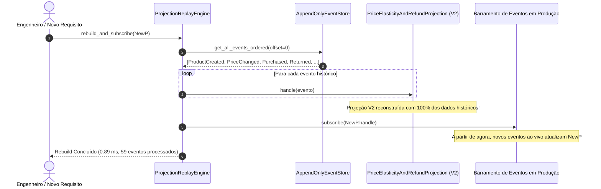

# Exemplo 06: Reconstrução de Projeções a partir de Replay de Eventos (Zero-Downtime Projection Rebuild)

Este exemplo demonstra um dos superpoderes mais transformadores do padrão **Event Sourcing**: a capacidade de responder a **novos requisitos de negócio e novos KPIs no futuro**, reconstruindo uma projeção de leitura do zero a partir do histórico imutável de eventos, sem qualquer indisponibilidade (*zero downtime*) no modelo de escrita.

---

## 1. O Dilema do CRUD e a Perda Irreversível de Dados

Em sistemas tradicionais baseados em CRUD relacional:
1. Uma tabela `products` possui apenas o estado atual (`price = 450.00`, `total_sold = 44`).
2. Seis meses após o lançamento do sistema, a diretoria solicita um relatório de **elasticidade de preços e taxa de devolução**:
   > *"Sempre que alteramos o preço de um produto no passado, como as vendas reagiram e qual foi o percentual de devoluções em cada faixa de preço?"*
3. **No CRUD tradicional, esse requisito é IMPOSSÍVEL de atender retroativamente:** Os preços antigos foram destruídos por comandos `UPDATE products SET price = ...`. Apenas dados a partir da criação de novas colunas/tabelas poderão ser coletados no futuro.

---

## 2. A Solução com Event Sourcing: Projection Replay

Como o **Event Store** preserva todos os fatos consumados de forma imutável desde o primeiro dia:
- `ProductCreated`
- `PriceChanged`
- `ProductPurchased`
- `ProductReturned`

Para implantar a nova visão analítica:
1. Criamos um novo Projetor: `PriceElasticityAndRefundProjection`.
2. O **`ProjectionReplayEngine`** consome o stream global desde o offset 0 até o offset atual $N$.
3. A nova projeção é populada com todo o histórico retroativo em milissegundos.
4. O projetor é então conectado ao barramento de eventos em produção para continuar recebendo novos eventos em tempo real.
5. **Impacto no modelo de escrita:** ZERO. Nenhuma tabela transacional foi alterada ou bloqueada.



---

## 3. Estrutura de Arquivos

```
06-event-replay-projection-rebuild/
├── domain/
│   ├── aggregate.py            # ProductAggregate
│   └── events.py               # ProductCreated, PriceChanged, ProductPurchased, ProductReturned
├── infrastructure/
│   └── event_store.py          # AppendOnlyEventStore com timeline global
├── projections/
│   ├── catalog_view.py         # Projeção Legada V1 (preço atual e vendas)
│   └── elasticity_analysis.py  # Nova Projeção V2 (elasticidade, devoluções por faixa de preço)
├── engine/
│   └── replay_engine.py        # Motor de Replay e subscrição contínua
├── main.py                     # Demonstração executável do ciclo de vida
└── README.md                   # Esta documentação
```

---

## 4. Como Executar

```bash
python3 06-event-replay-projection-rebuild/main.py
```
