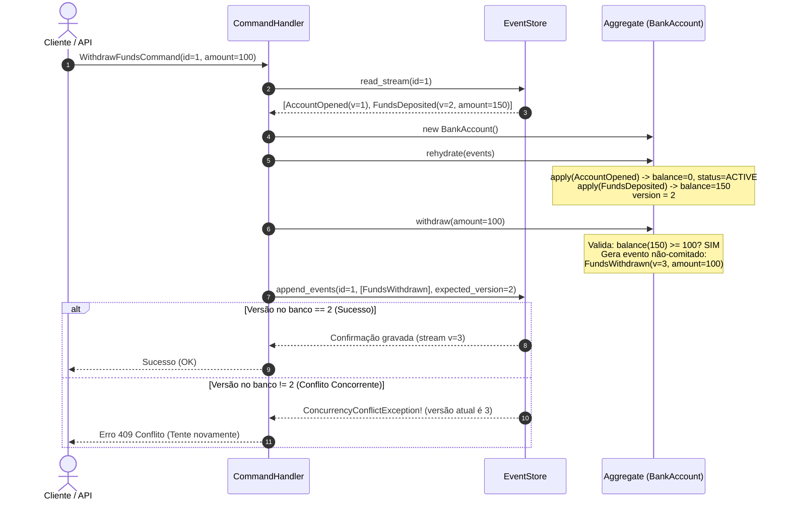

# Arquitetura CQRS e Event Sourcing (Command Query Responsibility Segregation & Event Sourcing)

> **"Asking a question should not change the answer."**  
> — Bertrand Meyer, criador do princípio *Command-Query Separation* (CQS)
>
> **"Event Sourcing ensures that all changes to application state are stored as a sequence of events. Not just the current state, but the complete history of how we got there."**  
> — Martin Fowler

---

## 1. Introdução e Contexto Histórico

A arquitetura tradicional de sistemas corporativos baseia-se historicamente no modelo **CRUD (Create, Read, Update, Delete)** apoiado em bancos de dados relacionais centrados em **estado atual**. Nesse paradigma convencional, quando uma entidade sofre uma alteração — por exemplo, quando o saldo de uma conta bancária é decrementado ou o endereço de entrega de um pedido é modificado —, a linha correspondente no banco de dados é **sobrescrita (`UPDATE`)**. Todas as versões anteriores daquele dado são irrevogavelmente destruídas, a menos que um subsistema secundário de auditoria (tabelas `_audit` ou logs ad-hoc) tenha sido manualmente configurado.

Além disso, em sistemas CRUD de média e grande escala, o mesmo modelo de dados relacional normalizado (3NF) precisa atender a dois propósitos diametralmente opostos com forças e requisitos conflitantes:
1. **O Caminho de Escrita (Write Path / Transacional):** Requer alta consistência, bloqueios transacionais (ACID), validação rígida de invariantes de negócio, tabelas altamente normalizadas para evitar anomalias de atualização, e operações focadas em uma única entidade ou raiz de agregado (*Aggregate Root*).
2. **O Caminho de Leitura (Read Path / Consultas):** Requer alta vazão (*throughput*), baixa latência, agregações complexas, múltiplos *JOINs* entre dezenas de tabelas, buscas textuais, paginação e visualizações desnormalizadas sob medida para interfaces de usuário (UIs) ou integrações.

A tentativa de conciliar essas duas forças em um único modelo de domínio relacional invariavelmente resulta em compromissos dolorosos: tabelas desnormalizadas degradam a integridade das escritas; modelos estritamente normalizados provocam *queries* lentas repletas de *JOINs*; bloqueios de leitura concorrem com transações de escrita; e o crescimento do volume de dados torna o sistema lento e frágil.

Para resolver essa dicotomia estrutural surgiram dois padrões fundamentais da engenharia de software contemporânea: **CQRS** e **Event Sourcing**.

---

### A Genealogia: CQS $\rightarrow$ CQRS $\rightarrow$ Event Sourcing

```
       1988: Bertrand Meyer (Object-Oriented Software Construction)
                 │
                 ▼
       Command-Query Separation (CQS)
       "Um método deve mudar o estado de um objeto OU retornar um resultado, nunca ambos."
                 │
                 │ (Evolução arquitetural para sistemas distribuídos)
                 ▼
       2006-2010: Greg Young, Udi Dahan, Martin Fowler
                 │
                 ▼
       Command Query Responsibility Segregation (CQRS)
       "Separe completamente o modelo conceitual e físico de Escrita do modelo de Leitura."
                 │
                 │ (Integração simbiótica de persistência)
                 ▼
       Event Sourcing (ES)
       "O estado atual da aplicação é uma derivada pura da sequência de eventos de domínio imutáveis."
```

1. **Command-Query Separation (CQS) — Bertrand Meyer (1988):**
   Formulado no contexto da linguagem Eiffel, o CQS é um princípio no nível de classes e métodos:
   - Um método é um **Command** (mutador) se altera o estado interno do objeto. Deve ter retorno `void` (não retornar valor).
   - Um método é uma **Query** se calcula e retorna um valor. Deve ser uma função pura (*side-effect free*).
2. **Command Query Responsibility Segregation (CQRS) — Greg Young (2006):**
   Greg Young elevou o CQS do nível de métodos para o **nível de arquitetura de software**. No CQRS, o sistema é dividido em duas pilhas completamente autônomas:
   - **Command Stack (Write Side):** Recebe intenções de negócio imperativas (*Commands*), valida regras e invariantes no modelo de domínio, e persiste as alterações.
   - **Query Stack (Read Side):** Executa consultas puras sobre modelos de visualização (*Read Models / Projections*) desnormalizados e indexados especificamente para a resposta imediata das telas e relatórios, sem qualquer bloqueio ou dependência do modelo de escrita.
3. **Event Sourcing (ES) — Martin Fowler & Greg Young (2005-2006):**
   Embora o CQRS possa ser implementado com bancos relacionais tradicionais, ele atinge sua máxima sinergia quando combinado com o **Event Sourcing**. Em vez de persistir o "estado atual" como uma linha de tabela, persistimos cada mutação como um **Evento de Domínio Imutável** (*Domain Event*) em um **Event Store** *append-only*. O estado atual de qualquer agregado em qualquer instante de tempo é simplesmente a soma cumulativa (*fold/reduce*) de todos os seus eventos passados:
   $$\text{CurrentState} = \text{fold}(\text{apply}, \text{InitialState}, \text{Events}[0 \dots N])$$

---

## 2. Pilares e Mecânica Fundamental

```mermaid
flowchart TD
    subgraph UI ["Camada de Usuário / API Externa"]
        UserAction["Ação do Usuário\n(Ex: Sacar R$ 100)"]
        UserQuery["Consulta\n(Ex: Ver Extrato)"]
    end

    subgraph WriteSide ["Write Model (Command Stack)"]
        Cmd["Command: WithdrawFundsCommand"]
        Handler["Command Handler"]
        Agg["Aggregate Root\n(BankAccountAggregate)"]
        Invariants{"Invariantes de Domínio\n(Saldo >= R$ 100? Conta Ativa?)"}
        EventGen["Gerador de Evento\n(FundsWithdrawn)"]
    end

    subgraph Persistence ["Persistência Imutável"]
        EventStore[("Append-Only Event Store\nStreams de Eventos Imutáveis\nVersão Otimista (OCC)")]
        Snapshots[("Snapshot Store\n(Estado a cada N eventos)")]
    end

    subgraph ProjectionEngine ["Mecanismo de Projeção"]
        Dispatcher["Event Dispatcher / Bus"]
        P1["Projector 1:\nAccountSummaryProjector"]
        P2["Projector 2:\nStatementListProjector"]
        P3["Projector 3:\nFraudDetectionProjector"]
    end

    subgraph ReadSide ["Read Model (Query Stack)"]
        RM1[("Read Model 1:\nResumo da Conta (Key-Value)")]
        RM2[("Read Model 2:\nExtrato Transacional (Tabela)")]
        RM3[("Read Model 3:\nScore de Fraude")]
        QH["Query Handlers"]
    end

    UserAction -->|1. Envia Command| Cmd
    Cmd -->|2. Roteia| Handler
    Handler -->|3. Carrega Eventos & Re-hidrata| EventStore
    EventStore -.->|4. Stream de Eventos| Agg
    Snapshots -.->|Opcional: Último Snapshot| Agg
    Agg -->|5. Valida Regras| Invariants
    Invariants -- Aprovado -->|6. Emite Novo Evento| EventGen
    EventGen -->|7. Append Atômico (OCC)| EventStore
    EventStore -->|8. Publica Eventos Confirmados| Dispatcher
    Dispatcher -->|9. Atualiza Assíncrono/Síncrono| P1
    Dispatcher -->|9. Atualiza| P2
    Dispatcher -->|9. Atualiza| P3
    P1 -->|10. Upsert| RM1
    P2 -->|10. Insert| RM2
    P3 -->|10. Upsert| RM3
    UserQuery -->|11. Dispara Query| QH
    QH -->|12. Consulta Direta Sem Joins| RM1
    QH -->|12. Consulta Direta| RM2
    QH -->|13. Retorna DTO Imediato| UserQuery
```

---

### Os 7 Componentes Fundamentais

1. **Commands (Comandos):**
   - Mensagens com verbo no **imperativo** (`OpenAccount`, `WithdrawFunds`, `CancelOrder`).
   - Representam a **intenção** do usuário de modificar o estado do sistema.
   - Podem ser **rejeitados** se as invariantes de negócio não forem satisfeitas.
   - São direcionados a exatamente **um único Command Handler**.

2. **Command Handlers:**
   - Orquestram o fluxo de escrita: recebem o comando, carregam o agregado correspondente a partir do Event Store, executam o método de negócio no agregado e gravam os novos eventos gerados.
   - Não contêm lógica de negócio; delegam todas as regras para o Agregado.

3. **Aggregate Root (Raiz do Agregado):**
   - Fronteira transacional e guardião das invariantes de domínio (conceito do Domain-Driven Design).
   - Em Event Sourcing, o agregado não possui setters nem mutações diretas. Seu estado interno é reconstruído via **Re-hidratação** (*Rehydration*), invocando métodos internos `apply(event)`.
   - Quando executa uma operação, avalia se a regra permite a ação. Se permitir, instancia um novo evento e o adiciona à lista de eventos não confirmados (*uncommitted events*).

4. **Append-Only Event Store (Repositório de Eventos):**
   - Banco de dados que suporta apenas duas operações: `append_events(stream_id, events, expected_version)` e `read_stream(stream_id)`.
   - **Nunca executa `UPDATE` ou `DELETE`**.
   - Implementa **Controle de Concorrência Otimista (OCC - Optimistic Concurrency Control)**: se dois comandos tentarem gravar eventos no mesmo stream com a mesma versão esperada simultaneamente, a segunda gravação falha com `ConcurrencyConflictException`.

5. **Domain Events (Eventos de Domínio):**
   - Fatos que já ocorreram no passado, expressos com verbo no **passado** (`AccountOpened`, `FundsWithdrawn`, `OrderPlaced`).
   - São **imutáveis** e carregam todos os dados contextuais necessários para que qualquer consumidor compreenda o fato sem precisar consultar outros serviços.

6. **Projections (Projetores) & Read Models:**
   - Consumidores especializados que escutam o fluxo de eventos e atualizam modelos de leitura desnormalizados (*Materialized Views*).
   - Os modelos de leitura são desenhados exclusivamente para leitura rápida: sem chaves estrangeiras complexas, sem normalização excessiva, indexados pelas chaves de busca da tela.

7. **Snapshots (Instantâneos de Estado):**
   - Otimização de desempenho para fluxos com milhares de eventos.
   - A cada $N$ eventos (ex: a cada 100 eventos), o estado serializado do agregado é gravado no Snapshot Store.
   - Na próxima re-hidratação, o agregador carrega o snapshot da versão $N$ e lê apenas os eventos da versão $N+1$ em diante, reduzindo a complexidade de reconstrução de $O(E)$ para $O(E \pmod N)$.

---

## 3. Matriz Comparativa: CRUD vs. CQRS Puro vs. CQRS + Event Sourcing

| Critério | CRUD Tradicional | CQRS sem Event Sourcing | CQRS + Event Sourcing |
| :--- | :--- | :--- | :--- |
| **Persistência de Dados** | Estado atual sobrescrito (`UPDATE`/`DELETE`) | Estado atual persistido separadamente em tabelas de escrita e leitura | Append-only log de eventos imutáveis; tabelas de leitura projetadas |
| **Auditoria e Rastreabilidade** | Quase nula; requer logs ad-hoc ou tabelas sombra | Parcial (triggers ou logs de auditoria) | **Nativa e Total (100%)**: cada evento é um registro histórico auditável |
| **Capacidade de "Viagem no Tempo"** | Impossível sem backups ponto-a-ponto | Impossível | **Nativa**: qualquer estado passado pode ser reidratado no instante $T$ |
| **Conflitos de Concorrência** | Pessimista (Lock de linhas) ou Otimista (coluna `version`) | Otimista no modelo de escrita | Otimista estrito no número de versão do Stream de Eventos |
| **Evolução de Esquema e Novos KPIs** | Migrações complexas (`ALTER TABLE`, dados antigos perdidos) | Migrações no banco de escrita e sincronização de leitura | **Replay de Projeções**: crie um novo projetor e processe o histórico desde o início |
| **Complexidade Cognitiva / Código** | Baixa a Média (padrão em frameworks MVC) | Média (dois modelos a manter e sincronizar) | Alta (Agregados, Handlers, Event Store, Projeções, OCC, Eventual Consistency) |
| **Consistência de Leitura** | Forte (Imediata via ACID) | Forte ou Eventual | Tipicamente **Eventual Consistency** (ou Forte em memória/síncrono) |
| **Desempenho de Leitura vs Escrita** | Conflitante; escritas competem com leituras pesadas | Independente; leitura otimizada | Ultra-escalável; escritas são simples `INSERT`s, leituras são *key-value* diretas |

---

## 4. O Ciclo de Re-hidratação e Controle de Concorrência Otimista (OCC)



---

## 5. Invariantes Rígidas: O que NUNCA fazer em CQRS & Event Sourcing

> [!CAUTION]
> **Anti-Padrão 1: Consultar Projeções de Leitura dentro do Agregado para Validar Invariantes**  
> O agregado deve ser **100% autônomo** para validar suas regras de negócio. Se um comando precisar de um dado para validar uma regra, esse dado deve estar no estado re-hidratado do próprio agregado ou ser explicitamente fornecido como argumento do comando. **Nunca faça queries no Read Model dentro do Write Model**, pois o Read Model é eventualmente consistente e introduzirá condições de corrida catastróficas.

> [!WARNING]
> **Anti-Padrão 2: Mutação de Eventos Passados**  
> Eventos são fatos históricos consumados. Uma vez persistidos no Event Store, **nunca execute UPDATE ou DELETE** em um evento gravado. Se um erro foi cometido (ex: depósito com valor duplicado), o sistema deve emitir um **evento de compensação** (ex: `DepositReversed` ou `CorrectionApplied`), assim como na contabilidade de partidas dobradas.

> [!IMPORTANT]
> **Anti-Padrão 3: Eventos Genéricos Sem Significado Semântico**  
> Evite eventos anêmicos como `EntityUpdated(fields={"name": "X"})`. Cada evento deve refletir uma transição de intenção rica de negócio: `CustomerAddressChanged`, `ItemDiscountApplied`, `SubscriptionRenewed`. Isso preserva o contexto exato e a semântica da ação para projeções futuras.

> [!NOTE]
> **Anti-Padrão 4: Executar Efeitos Colaterais Externos nos Métodos `apply(event)`**  
> Os métodos `apply(event)` do agregado são executados tanto durante a execução de uma nova operação quanto durante a **re-hidratação histórica de eventos gravados há meses**. Se você disparar envio de e-mails, requisições HTTP ou geração de GUIDs dentro de `apply()`, eles serão disparados repetidamente toda vez que o agregado for carregado da memória.

---

## 6. Catálogo dos 6 Exemplos Práticos Implementados

Esta pasta contém 6 implementações completas, autocontidas e executáveis em Python puro 3.10+, demonstrando diferentes facetas e requisitos da arquitetura CQRS e Event Sourcing:

1. [`01-bank-account-event-sourced`](./01-bank-account-event-sourced/)
   - **Domínio:** Livro-Razão Bancário (*Financial Ledger*).
   - **Conceitos:** Invariantes rígidas de saldo e status, Event Store com Controle de Concorrência Otimista (OCC), projeção de Resumo da Conta e Extrato Transacional.
2. [`02-ecommerce-shopping-cart-projections`](./02-ecommerce-shopping-cart-projections/)
   - **Domínio:** Carrinho de Compras E-Commerce com Múltiplas Visões.
   - **Conceitos:** Multi-projeções a partir do mesmo stream de eventos: visão viva do cliente (carrinho ativo) versus visão analítica de funil de marketing (carrinhos abandonados e receita perdida).
3. [`03-aggregate-snapshotting-performance`](./03-aggregate-snapshotting-performance/)
   - **Domínio:** Motor de Telemetria / Personagem de Jogos em Tempo Real (*Player Aggregate*).
   - **Conceitos:** Mecanismo de Snapshots periódicos para evitar degradação $O(N)$ em agregados de alta frequência. Benchmark comparativo de tempo de re-hidratação (Replay integral vs. Snapshot + Delta).
4. [`04-temporal-time-travel-audit`](./04-temporal-time-travel-audit/)
   - **Domínio:** Progressão de Carreira e Folha de Pagamento Regulatória (*HR Compliance*).
   - **Conceitos:** Motor de "Viagem no Tempo" (*Temporal Replay Engine*). Consulta ao estado exato de qualquer funcionário em qualquer carimbo de data/hora arbitrário ($t$) para auditorias fiscais e trabalhistas.
5. [`05-crypto-order-book-cqrs`](./05-crypto-order-book-cqrs/)
   - **Domínio:** Livro de Ofertas L2 (*Level 2 Order Book*) de Corretora Cripto.
   - **Conceitos:** Write model de alta velocidade processando ordens, execuções e cancelamentos; Read models desnormalizados em tempo real: Gráfico de Profundidade (*Depth Chart*) e Ticker 24h.
6. [`06-event-replay-projection-rebuild`](./06-event-replay-projection-rebuild/)
   - **Domínio:** Catálogo de Produtos e Análise de Elasticidade de Preço.
   - **Conceitos:** Evolução de requisitos e *Zero-Downtime Replay*. Construção de uma nova projeção complexa a partir do início da história dos eventos sem modificar o modelo de escrita existente.

---

## 7. Como Executar os Exemplos

Todos os exemplos utilizam exclusivamente a biblioteca padrão do Python (`typing`, `dataclasses`, `abc`, `uuid`, `time`, `datetime`, `copy`, etc.).

```bash
# Executar o Exemplo 01 (Banco de Eventos com OCC)
python3 01-bank-account-event-sourced/main.py

# Executar o Exemplo 02 (Projeções de E-Commerce)
python3 02-ecommerce-shopping-cart-projections/main.py

# Executar o Exemplo 03 (Snapshots e Benchmark)
python3 03-aggregate-snapshotting-performance/main.py

# Executar o Exemplo 04 (Auditoria com Time Travel)
python3 04-temporal-time-travel-audit/main.py

# Executar o Exemplo 05 (Order Book Cripto L2)
python3 05-crypto-order-book-cqrs/main.py

# Executar o Exemplo 06 (Replay e Rebuild de Projeção)
python3 06-event-replay-projection-rebuild/main.py
```
