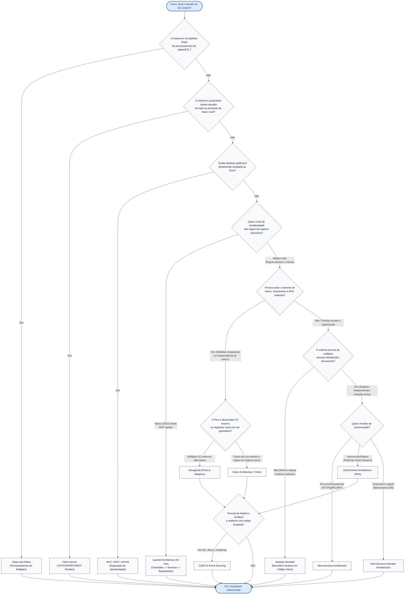

# 🏛️ Studies of Architectures (Guia Prático e Definitivo de Arquiteturas de Software)

> Um repositório de referência técnica, consulta contínua e estudos aprofundados sobre as principais arquiteturas de software do mercado, com implementações limpas em **Python 3**, foco em **Clean Code**, **SOLID**, **Clean Architecture** e casos reais do cotidiano de engenharia.

---

## 🎯 Propósito do Repositório

Arquitetura de software não é sobre desenhar caixas e flechas que nunca saem do papel, nem sobre aplicar complexidade desnecessária para criar "catedrais de software". Arquitetura é sobre **sustentabilidade**, **gerenciamento de mudanças**, **clareza de fronteiras** e **facilidade de teste e evolução**.

Este repositório foi construído para sanar uma dor crônica da área: **a carência de exemplos reais, funcionais e auto-contidos** que conectem a teoria dos livros (*Clean Architecture, DDD, Enterprise Integration Patterns, POSA*) aos desafios do dia a dia (e-commerce, pagamentos, faturamento recorrente, auditoria, telemetria, integrações e mensageria).

---

## 🧭 Princípios Norteadores: Clean Code & SOLID em Python

Todas as implementações deste repositório seguem os seguintes pilares fundamentais de engenharia de software:

### 1. Clean Code na Prática (PEP 8 + Idiomático)
- **Nomes Intencionais e Reveladores de Intenção**: Variáveis, classes e métodos revelam o *porquê* de existirem. Sem abreviações crípticas (`usr_mgr` vira `UserRegistrationService`).
- **Funções Pequenas e com Único Nível de Abstração (SLAP)**: Funções realizam apenas uma coisa e a fazem bem.
- **Evitar Efeitos Colaterais Ocultos**: Métodos de consulta (`queries`) não alteram o estado do sistema; comandos (`commands`) realizam mutações previsíveis (CQS).
- **Tratamento de Exceções Explícito**: Erros de domínio são modelados como exceções de domínio ricas (`DomainException`), não retornando códigos numéricos mágicos ou `None` silencioso.
- **Auto-documentação**: O código deve ser tão legível que os comentários se limitem a explicar o *motivo* (decisões de negócio), nunca o *como*.

### 2. Princípios SOLID Aplicados
- **S - Single Responsibility Principle (SRP)**: Cada classe ou módulo possui apenas um único motivo para mudar (um único ator ou interesse de negócio).
- **O - Open/Closed Principle (OCP)**: Entidades estão abertas para extensão através de abstrações (`typing.Protocol` ou `abc.ABC`), mas fechadas para modificação.
- **L - Liskov Substitution Principle (LSP)**: Subclasses e implementações de adaptadores podem substituir suas abstrações sem quebrar o comportamento esperado do chamador.
- **I - Interface Segregation Principle (ISP)**: Interfaces granulares e específicas para cada cliente, evitando interfaces "gordas" cheias de métodos que nem todos os consumidores utilizam.
- **D - Dependency Inversion Principle (DIP)**: O código de negócio de alto nível nunca depende de detalhes de infraestrutura de baixo nível. Ambos dependem de abstrações (Inversão de Controle).

---

## 🗺️ Mapa Completo das 12 Arquiteturas

O repositório é composto por **12 padrões arquiteturais canônicos**, cada um com seu próprio guia detalhado e **6 exemplos práticos do mundo real** (totalizando 72 projetos funcionais):

| # | Arquitetura | Paradigma Principal | Casos Típicos do Dia a Dia | Link da Pasta |
|---|-------------|---------------------|----------------------------|---------------|
| **01** | **Client-Server** | Comunicação de rede síncrona/assíncrona cliente-servidor | Chat via socket, APIs REST, DNS, RPC remoto, Coleta IoT, Connection Pooling | [`01-client-server/`](./01-client-server/) |
| **02** | **Layered (N-Tier)** | Camadas com fluxo unidirecional de dependência | Sistemas corporativos clássicos, Gestão de pedidos, Auth/RBAC, Extratos, Agendamento | [`02-layered-architecture/`](./02-layered-architecture/) |
| **03** | **MVC (Model-View-Controller)** | Segregação de apresentação, controle e modelo | Dashboards com templates, Kanban boards, Orçamento pessoal, PDV/Frente de caixa | [`03-mvc-architecture/`](./03-mvc-architecture/) |
| **04** | **Pipes and Filters** | Transformação sequencial e pipelines de dados | Processamento de extratos bancários (ETL), Sanitização LGPD, Compiladores, Mídia | [`04-pipes-and-filters/`](./04-pipes-and-filters/) |
| **05** | **Hexagonal (Ports & Adapters)** | Núcleo de domínio isolado por Portas e Adaptadores | Gateways de pagamento múltiplos, Notificações multicanal, Storage agnóstico (S3/Local) | [`05-hexagonal-architecture/`](./05-hexagonal-architecture/) |
| **06** | **Clean Architecture** | Regra de dependência centrada em Casos de Uso | SaaS de cobrança, Moderação de redes sociais, PIX/TED bancário, Matching de delivery | [`06-clean-architecture/`](./06-clean-architecture/) |
| **07** | **Onion Architecture** | Domínio concêntrico guiado por Domain-Driven Design | Reserva de hotéis, Folha de pagamento com encargos, Locação de frotas, Seguros | [`07-onion-architecture/`](./07-onion-architecture/) |
| **08** | **Modular Monolith** | Monólito com Bounded Contexts estritamente isolados | ERP corporativo (Vendas/RH/Fiscal), Marketplace multivendor, Telemedicina, Fidelidade | [`08-modular-monolith/`](./08-modular-monolith/) |
| **09** | **SOA (Service-Oriented)** | Integração corporativa baseada em contratos e ESB | Integração com Mainframe legado, Ativação de telecom, Emissão de bilhetes aéreos | [`09-soa-service-oriented/`](./09-soa-service-oriented/) |
| **10** | **Microservices** | Sistemas distribuídos autônomos por serviço | API Gateway/BFF, Sagas Coreografadas/Orquestradas, Circuit Breakers, Service Discovery | [`10-microservices-architecture/`](./10-microservices-architecture/) |
| **11** | **Event-Driven Architecture (EDA)** | Reatividade assíncrona orientada a eventos | Ciclo de corridas ride-sharing, Detecção de fraude em streaming, Outbox Pattern | [`11-event-driven-architecture/`](./11-event-driven-architecture/) |
| **12** | **CQRS & Event Sourcing** | Segregação de leitura/escrita e histórico imutável | Ledger de conta corrente com replay, Reserva de assentos aéreos, Auditoria médica | [`12-cqrs-and-event-sourcing/`](./12-cqrs-and-event-sourcing/) |

---

## 📊 Matriz Comparativa de Decisão Arquitetural

Utilize esta matriz para avaliar rapidamente a relação de custo-benefício de cada abordagem antes de iniciar um projeto:

```
Complexidade Baixa  ──────────────────────────────────────────►  Complexidade Alta
[Client-Server] -> [Layered/MVC] -> [Pipes&Filters] -> [Hexagonal/Clean/Onion] -> [Modular Monolith] -> [EDA/Microservices/CQRS]
```

| Arquitetura | Complexidade Cognitiva | Desacoplamento do Domínio | Custo de Infraestrutura | Testabilidade sem Mocks Pesados | Quando Usar | Quando NÃO Usar (Armadilha) |
|-------------|:---------------------:|:-------------------------:|:-----------------------:|:-------------------------------:|-------------|-----------------------------|
| **Client-Server** | Muito Baixa | Baixo | Mínimo | Moderada | Protocolos dedicados, ferramentas de rede, CLI-daemon, IoT direto. | Não use para sistemas de negócio com regras corporativas densas. |
| **Layered (N-Tier)** | Baixa | Moderado | Baixo | Média | Sistemas CRUD tradicionais, MVPs rápidos, sistemas corporativos convencionais. | Evite quando a regra de negócio for complexa e o banco começar a vazar para a UI. |
| **MVC** | Baixa | Baixo a Médio | Baixo | Média | Aplicações com forte acoplamento entre estado visual e interação do usuário. | Evite para backends puros ou APIs onde não há "View" renderizada diretamente. |
| **Pipes & Filters** | Moderada | Alto (por etapa) | Baixo a Médio | Alta (por filtro) | ETLs, transformações de streaming, processamento multimídia, pipelines de validação. | Evite para sistemas transacionais interativos baseados em requisição-resposta CRUD. |
| **Hexagonal** | Média | Muito Alto | Baixo a Médio | Altíssima | Sistemas que integram muitas APIs externas variantes (ex: 4 gateways de pagamento). | Evite para CRUDs triviais sem integrações externas dinâmicas (overengineering). |
| **Clean Architecture** | Alta | Máximo | Baixo a Médio | Altíssima | Domínios ricos, longa vida útil do software, múltiplas interfaces de entrada (Web, CLI, Job). | Evite para projetos curtos, scripts simples ou aplicações descartáveis. |
| **Onion Architecture** | Alta | Máximo (DDD) | Baixo a Médio | Altíssima | Domínios corporativos altamente complexos onde DDD com entidades puras é vital. | Evite se a equipe não domina DDD e inversão de dependência. |
| **Modular Monolith** | Média a Alta | Alto | Baixo | Alta | Times em crescimento em um mesmo produto que precisam de limites antes de microsserviços. | Evite se os módulos exigirem tecnologias, linguagens ou escalabilidades físicas distintas. |
| **SOA** | Alta | Alto (Corporativo)| Alto | Média | Ambientes empresariais legados que precisam interoperar via barramento compartilhado (ESB). | Evite em startups ágeis e sistemas modernos que não dependem de barramentos corporativos. |
| **Microservices** | Muito Alta | Máximo (Físico) | Alto a Muito Alto | Complexa (E2E) | Múltiplos times grandes trabalhando com deploys e escalabilidade independentes. | Evite para times pequenos (menos de 20-30 devs) ou quando o domínio ainda não está claro. |
| **Event-Driven (EDA)** | Alta | Máximo (Temporal) | Médio a Alto | Moderada | Sistemas reativos, telemetria em tempo real, pipelines assíncronos e desacoplamento total. | Evite quando consistência forte imediata (ACID síncrono) for requisito inegociável. |
| **CQRS & Event Sourcing**| Muito Alta | Máximo | Médio a Alto | Altíssima | Sistemas que exigem trilha de auditoria completa à prova de fraude, replay temporal e alto throughput de leitura. | Evite se um banco relacional simples com colunas tradicionais atender sem necessidade de histórico de eventos. |

---

## 🧭 Fluxograma de Tomada de Decisão: Qual Arquitetura Escolher?

O fluxograma abaixo serve como uma bússola rápida para navegar entre os modelos:



---

## 📁 Padrão Estrutural de Cada Pasta de Arquitetura

Cada uma das 12 pastas principais segue este modelo rigoroso:

```text
[xx-nome-da-arquitetura]/
├── README.md                              # Documentação Teórica Completa
│   ├── 1. O que é e Origem Histórica
│   ├── 2. Diagrama Conceitual (Mermaid)
│   ├── 3. Regras Invariantes (O que NUNCA fazer)
│   ├── 4. Vantagens e Trade-offs Reais
│   ├── 5. Quando Usar vs Quando NÃO Usar
│   └── 6. Índice Detalhado dos 6 Exemplos Práticos
│
├── 01-[cenario-pratico-1]/
│   ├── README.md                          # Explicação do Caso, Justificativa, Diagrama Mermaid e Como Rodar
│   └── src/                               # Código limpo em Python 3 com ponto de entrada (main.py ou tests)
├── 02-[cenario-pratico-2]/
├── 03-[cenario-pratico-3]/
├── 04-[cenario-pratico-4]/
├── 05-[cenario-pratico-5]/
└── 06-[cenario-pratico-6]/
```

---

## 🚀 Como Executar os Exemplos

Todos os exemplos utilizam **Python 3.10+** e foram concebidos com **zero fricção**:
- Não exigem instalação de bancos de dados externos nem containers pesados para rodar a demonstração arquitetural.
- Repositórios e adaptadores contam com implementações de memória robustas e contratos abstratos (`abc.ABC` ou `typing.Protocol`), comprovando a independência do domínio.

Para rodar qualquer exemplo:
```bash
# 1. Navegue até a pasta do exemplo desejado
cd 02-layered-architecture/01-ecommerce-order-management

# 2. Execute a demonstração diretamente
python3 main.py

# Ou rode os testes unitários daquele exemplo
python3 -m unittest discover -s tests
```

---

## 🤝 Convenções de Commits Adotadas

O projeto adota estritamente o padrão [Conventional Commits](https://www.conventionalcommits.org/):
- `docs(root): ...` — Atualizações na documentação mestre.
- `feat(client-server): ...` — Adição da arquitetura Cliente-Servidor e exemplos.
- `feat(layered): ...` — Adição da arquitetura em Camadas e exemplos.
- `feat(hexagonal): ...` — Adição da arquitetura Hexagonal e exemplos.
- Cada arquitetura constitui um **commit atômico independente**.

---

<div align="center">
  <sub>Construído com rigor técnico, paixão por engenharia de software e foco em excelência arquitetural.</sub>
</div>
